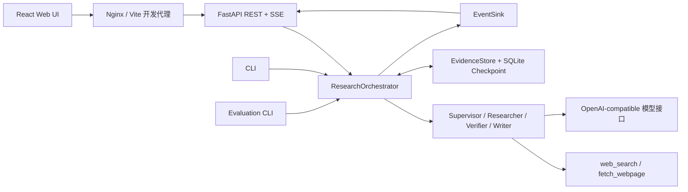
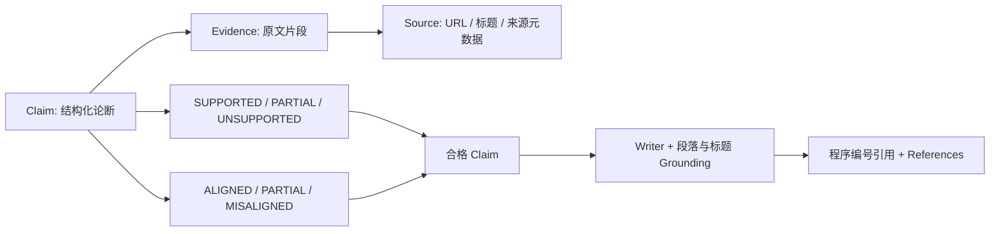

# DeepResearch Agent

将开放式研究问题转化为任务 DAG，搜索与读取资料，建立可追溯证据，再生成带编号引用的研究报告。

**Python · DeepAgents / LangGraph · FastAPI · React / TypeScript · SSE · SQLite · Docker Compose**

## Project Overview

DeepResearch Agent 是面向学术调研与行业研究的个人研究工作台。用户可以通过 CLI 或 Web 提交问题，观察任务执行、查看保存的报告，并追溯 **Claim → Evidence → Source**。各入口复用同一 ResearchOrchestrator，不维护另一套 Web 研究逻辑。

项目实现了 Phase 1～8 的研究、验证、报告、恢复、评估和 Web 交付链路。Phase 8D 提供单实例 Docker 部署文件；当前开发机没有 Docker Engine，容器启动和重启验收仍需在 Docker 环境执行。系统提供证据审计与模型判断，不承诺搜索完整、事实绝对正确或每次研究都成功。

## Core Features

- **Research Task DAG**：动态拆分 discovery / analysis / synthesis，校验依赖，按批次并行调度；单任务保留独立消息、工具与调用预算。
- **EvidenceStore**：从成功读取的原文提取 Source、Evidence、Claim，运行内去重、合并 provenance，供下游任务复用。
- **Claim Verification**：按批次判断证据支持程度；单独判断 Claim 与总体目标的相关性。
- **Gap-Driven Re-Research**：程序识别支持、相关性与覆盖缺口，在任务、轮次、搜索和模型调用预算内补研究。
- **Evidence-Grounded Report**：只将 `SUPPORTED + ALIGNED` Claim 用于正式发现，检查段落与标题的支持关系；必要时保守回退。
- **Deterministic Citation**：按报告首次使用顺序编号，从正式来源链生成 References，Citation 阶段不调用模型。
- **Checkpoint & Resume**：SQLite 保存 Run、安全快照、证据和报告；显式恢复失败或中断 Run，跳过已有完成标记。
- **FastAPI + React UI**：研究工作台、历史、任务依赖、Markdown 报告、引用链接和只读 Evidence Explorer。
- **Real-Time Streaming**：通过 SSE 展示 Task 和阶段进度、时间线；重连后读取 SQLite 状态校准。
- **Evaluation**：跨领域 Benchmark、简单 Baseline、内部质量指标、成本统计与可选单次 LLM Judge。

## System Architecture



各 Agent 角色对应独立提示、上下文和调用边界，可以复用同一个模型服务；不要求每个角色拥有独立模型或服务进程。后端默认同时运行 1 个 Run，Run 内 DAG 仍可并行。研究在后台线程执行，HTTP 请求不等待整份报告完成。

### Project Structure

```text
.
├── app/
│   ├── agents/                 # 规划、研究、验证、相关性、Writer
│   ├── api/                    # FastAPI、后台服务、公共 Schema、SSE
│   ├── persistence/            # SQLite Run / Checkpoint / 恢复
│   ├── prompts/                # 各角色提示
│   ├── research/               # DAG、证据、预算、缺口、引用、事件
│   ├── schemas/                # Task / Source / Evidence / Claim / Report
│   ├── tools/                  # 搜索和 HTML 读取
│   ├── config.py
│   └── llm.py                  # 模型工厂和参数适配
├── frontend/                   # React + TypeScript + Vite
│   ├── src/                    # 页面、API 客户端、SSE hook
│   ├── tests/                  # 浏览器工作流测试
│   └── Dockerfile              # Node 构建 → Nginx 静态站点
├── evaluation/                 # 指标、Baseline、Judge、Benchmark
├── tests/                      # 离线回归和显式启用的 Docker 验收
├── deploy/nginx.conf           # SPA、API / Swagger / SSE 代理
├── docs/                       # 专题文档、部署说明和开发记录
├── workspace/                  # 数据库和评估产物，不进入 Git / 镜像
├── main.py                     # 研究 CLI
├── evaluate.py                 # 独立评估 CLI
├── Dockerfile                  # FastAPI 后端
├── docker-compose.yml
├── .dockerignore
├── .env.example
└── pyproject.toml
```

## Research Workflow

1. **Plan**：Supervisor 选择互补研究子问题，生成 2～6 项任务并校验 DAG。
2. **Research**：执行依赖已完成的任务；discovery 搜索并读取资料，analysis 分析已有证据，synthesis 综合依赖链结果。
3. **Merge & Verify**：合并任务证据，批量验证本任务 Claim；保存安全检查点后再将任务标为完成。
4. **Relevance & Gaps**：评估目标相关性，生成支持、相关性与任务覆盖缺口。
5. **Re-Research**：最多一轮预算补研究，仅验证与评估新 Claim；允许缺口保留 OPEN。
6. **Write & Ground**：选择合格 Claim，生成报告，再检查表述是否扩大适用范围。
7. **Cite & Save**：程序生成编号与 References，通过完整性校验后保存到 SQLite。

工具失败、模型格式错误、超时或完整性错误都可能使 Run 失败。安全检查点保留，用户可显式 Resume；读取已保存报告不会重新调用 Writer。

## Evidence / Verification / Citation Design



- 每条正式 Claim 必须带 Evidence 引用，Evidence 必须能找到 Source。EvidenceStore 是 **Run 内结构化记忆**，不提供跨 Run 的长期知识检索。
- Verification 判断当前引用是否支持 Claim，Relevance 判断是否回答研究目标。`SUPPORTED` 不是外部世界真实性的保证。
- Writer 正式段落只引用 `SUPPORTED + ALIGNED` Claim；PARTIAL 结论只供限制说明。发布前检查语义范围，必要时保守回退。
- Citation 从正式 provenance 确定性生成，不由模型编造。合法引用链和编号不能替代事实核查。

## Checkpoint & Resume

SQLite 保存 Run、计划、任务结果、证据图、验证/相关性、补研究预算、报告和引用结果。检查点在既有安全边界提交，恢复时验证版本与引用完整性。

- 状态为 `RUNNING / COMPLETED / FAILED / INTERRUPTED`；已完成 Run 不重复研究。
- 重启服务会将遗留 RUNNING 标为 INTERRUPTED；**不会自动重跑**，需页面按钮或 Resume API 显式恢复。
- 已完成任务与已保存阶段会跳过；尚未完成或未提交的操作可能再次执行。
- 同一数据库只允许一个研究执行进程。API 单 worker；CLI / Evaluation 与 API 执行研究时使用不同数据库，或交替运行。

详情：[Persistence & Resume](docs/phase6-persistence.md)、[API 执行限制](docs/phase8a-api.md)。

## Evaluation

`research_benchmark_v2.json` 包含离线强化学习研究进展、中国游戏产业发展进展两个 Case。支持 Full、简单 Search-Summarize Baseline 和逐题对比：

```powershell
# 根目录；与使用同一数据库的 API 交替执行
.\.venv\Scripts\python.exe evaluate.py evaluation/benchmarks/research_benchmark_v2.json --mode compare --judge
```

输出 JSONL、JSON、CSV 和报告。指标包括支持率、相关性、可发布比例、任务覆盖、引用完整性、缺口修复，以及阶段调用、tokens、搜索/读取和耗时。

Judge 是基于报告与有限来源摘录的模型第二意见，评分 **0～4**；默认关闭，每份完成报告最多一次调用。Baseline 没有 Claim 审计流程，相应内部指标为 N/A。成功 Run 均值与失败消耗分开统计，缺少 usage 时不虚构完整 Token 总量。不同 Case / 样本数不能直接比较均值，当前实验不证明 Full 普遍优于 Baseline。

详情：[Evaluation & Benchmarking](docs/phase7-evaluation.md)。

## Tech Stack

| 层 | 实现 |
| --- | --- |
| 研究运行时 | Python ≥3.11、DeepAgents、LangChain、LangGraph |
| 模型接口 | langchain-openai / OpenAI SDK；DeepSeek、百炼 Qwen、SiliconFlow 参数适配 |
| 搜索与读取 | Tavily / DuckDuckGo；Requests、BeautifulSoup |
| 数据与验证 | Pydantic v2、SQLite WAL、安全 JSON Checkpoint |
| API / 进度 | FastAPI、Uvicorn、阶段/Task 级 SSE |
| 前端 | React、TypeScript、Vite、React Router、安全 Markdown |
| 部署 | Python 3.12、Node 22 构建、Nginx、Docker Compose |
| 测试 | pytest、httpx、Vitest、Playwright |

## Quick Start

需要 Python ≥3.11、Node ≥22.12、npm，以及模型、Tavily 和网页网络访问能力。

在根目录配置后端（PowerShell）：

```powershell
python -m venv .venv
.\.venv\Scripts\python.exe -m pip install -e ".[dev]"
# 仅首次创建；已有 .env 时保留原配置
Copy-Item .env.example .env
```

编辑 `.env` 的模型三项和 `TAVILY_API_KEY` 后启动：

```powershell
.\.venv\Scripts\python.exe -m app.api
```

另开终端，**先进入 frontend 目录再执行 npm 命令**：

```powershell
cd frontend
npm ci
npm run dev
```

- Web：**http://127.0.0.1:5173/**
- Swagger：http://127.0.0.1:8000/docs
- Health：http://127.0.0.1:8000/api/health

Linux / macOS 使用 `python3 -m venv .venv`、`.venv/bin/python -m pip install -e '.[dev]'`、`cp .env.example .env` 和 `.venv/bin/python -m app.api`；前端命令相同。

原 CLI 继续可用：

```powershell
.\.venv\Scripts\python.exe main.py "调研离线强化学习的最新发展"
.\.venv\Scripts\python.exe main.py --list-runs
.\.venv\Scripts\python.exe main.py --resume RUN_ID
```

## Docker Deployment

需要 Docker Engine 和 Compose v2（支持 `up --wait`）；Windows 使用 Docker Desktop 的 **Linux containers** 模式。

在根目录准备 `.env` 后执行：

```powershell
docker compose up -d --build --wait
docker compose ps
```

Web：**http://127.0.0.1:8080/**；Swagger：**http://127.0.0.1:8080/docs**。浏览器请求同源 `/api`，Nginx 转发到 `backend:8000`，并关闭 SSE 缓冲、保留 SPA 刷新路由。

```powershell
docker compose logs -f backend
docker compose restart
docker compose down
```

`research_data` Named Volume 挂载 `/data`，数据库固定 `/data/research.db`。普通 restart / down / up 保留 Volume、报告和 Checkpoint。**`down --volumes` 会删除研究数据，不用于日常重启。** 保持 Compose 项目名一致，否则会使用另一份 Volume。

容器默认使用独立新库，**不会自动导入本机 `workspace/research.db`**。迁移、一致性备份、环境更新和独立验收见 [Docker 部署说明](docs/phase8d-deployment.md)。

`.dockerignore` 排除真实 `.env`、数据库、workspace、Git、虚拟环境和 node_modules；密钥仅在运行时注入 backend。前后端使用非 root 用户，仅前端端口绑定主机 loopback。部署为 **单 backend / 单 worker / 单数据库实例**，不支持水平扩容。

## Environment Configuration

完整配置见 [.env.example](.env.example)，其中不包含真实密钥。已有 `.env` 不应覆盖或提交。

| 变量 | 用途 |
| --- | --- |
| `MODEL_API_KEY` / `MODEL_BASE_URL` / `MODEL_NAME` | 同一供应商的完整凭据、接口和模型名；不要混用不同服务的 key 与 URL。 |
| `TAVILY_API_KEY` | 搜索凭据，不是模型 API Key。 |
| `SILICONFLOW_API_KEY` / `SILICONFLOW_BASE_URL` | 旧配置回退；MODEL key / URL 必须同时留空。 |
| `VERIFIER_MODEL_*` | 可选独立验证模型；key / URL 覆盖需成对设置。 |
| `MODEL_REQUEST_TIMEOUT_SECONDS` | 请求超时，各阶段另有总预算。 |
| `*_MAX_TOKENS` / `MAX_*_CONTEXT_CHARS` | 分阶段输出/输入额度；放宽额度不保证结果更好。 |
| `RESEARCH_DB_PATH` | 本地默认 `workspace/research.db`，Compose 覆盖为 `/data/research.db`。 |
| `API_HOST` / `API_PORT` | 本地 `127.0.0.1:8000`，Compose 使用容器内 `0.0.0.0:8000`。 |
| `API_MAX_CONCURRENT_RUNS` | 默认 1，本部署固定为 1；不提供持久化队列。 |
| `API_CORS_ORIGINS` | 本地明确允许的 loopback Origin；Docker 同源代理为 `[]`。 |
| `API_SSE_*` | 心跳、状态校准、有界缓冲与连接数。 |
| `WEB_PORT` | Docker Web 主机端口，默认 8080，绑定 loopback。 |
| `EVAL_MODEL_NAME` | 可选 Judge 模型，复用供应商凭据。 |

DeepSeek 配置示例：

```dotenv
MODEL_API_KEY=replace-with-your-deepseek-api-key
MODEL_NAME=deepseek-flash
MODEL_BASE_URL=https://api.deepseek.com
TAVILY_API_KEY=replace-with-your-tavily-api-key
```

DeepSeek 官方接口使用非思考模式与 JSON Object；百炼 `qwen3.5-*` 的结构化阶段也使用 JSON Object 并关闭思考。JSON 有效不代表符合全部 Schema：额外字段、非法 ID、重复/遗漏结果仍会被现有校验拒绝。

前端公开配置见 `frontend/.env.example`，默认 `VITE_API_BASE_URL=/api`。Docker 前端固定同源 `/api`，不接收模型/搜索密钥。

## API Overview

| 方法 | 路径 | 功能 |
| --- | --- | --- |
| GET | `/api/health` | 服务和 SQLite 读取检查 |
| POST | `/api/runs` | `{"question":"..."}`；后台启动，立即返回 Run ID |
| GET | `/api/runs` | 最近 Run 列表 |
| GET | `/api/runs/{run_id}` | 持久化状态、计划、任务、阶段、公开错误摘要 |
| GET | `/api/runs/{run_id}/events` | SSE 进度、心跳和终态 |
| GET | `/api/runs/{run_id}/report` | 保存的报告与 References；未完成返回 409 |
| GET | `/api/runs/{run_id}/evidence` | 只读证据图与已有验证/相关性 |
| POST | `/api/runs/{run_id}/resume` | 显式恢复；运行中/已完成 Run 返回 409 |

不存在的 Run 返回 404；容量满返回 429，不创建无限等待队列。事件不包含网页全文、完整模型消息、密钥或本地路径。断开 SSE 不取消研究，终态由 Run API 确认。

详情：[8A API](docs/phase8a-api.md)、[8B 前端](docs/phase8b-frontend.md)、[8C SSE](docs/phase8c-streaming.md)。

## Screenshots

截图位置与拍摄说明：[docs/screenshots](docs/screenshots/README.md)。当前不嵌入未提供的图片，不用设计稿冒充运行截图。建议补充 Dashboard、运行中任务/SSE 时间线、带 References 的报告及 Evidence Explorer。

## Testing

```powershell
# 根目录，离线 Mock，避免真实模型调用
.\.venv\Scripts\python.exe -m pytest -q
cd frontend
npm test
npm run test:e2e
npm run build
```

浏览器测试默认使用本机 Chrome；也可安装 Playwright 浏览器并设置 `PLAYWRIGHT_CHANNEL=chromium`。覆盖 CLI、API、SSE、Checkpoint / Resume、报告与引用、证据链、刷新和错误状态。

Docker 验收显式启用，使用独立随机项目、测试凭据、Mock 数据和专用 Volume，覆盖启动、SSE 代理、强制中断、重启恢复、容器重建后的报告/证据及 CLI 读取，不调用真实模型：

```powershell
# 根目录；需 Docker Engine / Compose
$env:RUN_DOCKER_TESTS="1"
.\.venv\Scripts\python.exe -m pytest tests/test_deployment.py -q
Remove-Item Env:RUN_DOCKER_TESTS
```

本次验证及未实测部分见 [Phase 8D 验收说明](docs/phase8d-deployment.md#验证记录)。离线通过不代表所有模型、网页和网络条件下研究都会成功。

## Known Limitations

- **模型与来源**：会遗漏方向、误判支持/相关性或输出不合法字段；搜索不保证全面，部分 HTML、PDF、动态或受限站点无法读取。容器化不改变这些限制。
- **报告质量**：完整引用链、SUPPORTED 与 Grounding 不能保证没有事实错误；材料不足可能生成保守或较短的报告。
- **成本**：多轮请求、重复上下文、抽取和补研究可能显著增加 tokens，不保证优于简单 Baseline。
- **执行与恢复**：单 backend、单 worker，没有分布式队列或取消功能；未提交操作可能重做，不保证任意位置的精确一次执行。
- **SSE**：有界内存，不完整重放历史；刷新/重启从 SQLite 恢复当前状态，时间线记录本页收到的事件。
- **部署**：面向本机/可信环境，没有鉴权、多租户、TLS 或公网访问控制。基础镜像与 Python 依赖尚未锁定到内容摘要。
- **验收**：开发机未安装 Docker Engine，容器构建、Nginx 启动与 Volume 重启尚未实测，已有独立验收用例。

后续优先改进结构化输出稳定性、上下文/Token 效率与同题多次评估，再考虑鉴权、任务取消、依赖锁定和运维；不通过放松 Verification 或 Citation 掩盖失败。

## Development Notes

Phase 1～8C 完整记录与既有模型适配验收已迁移至 [Development History](docs/development-history.md)。专题文档：[Phase 6](docs/phase6-persistence.md)、[Phase 7](docs/phase7-evaluation.md)、[Phase 8D](docs/phase8d-deployment.md)。
