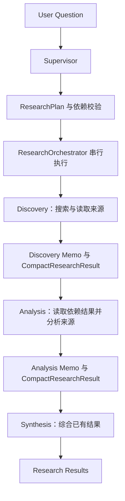
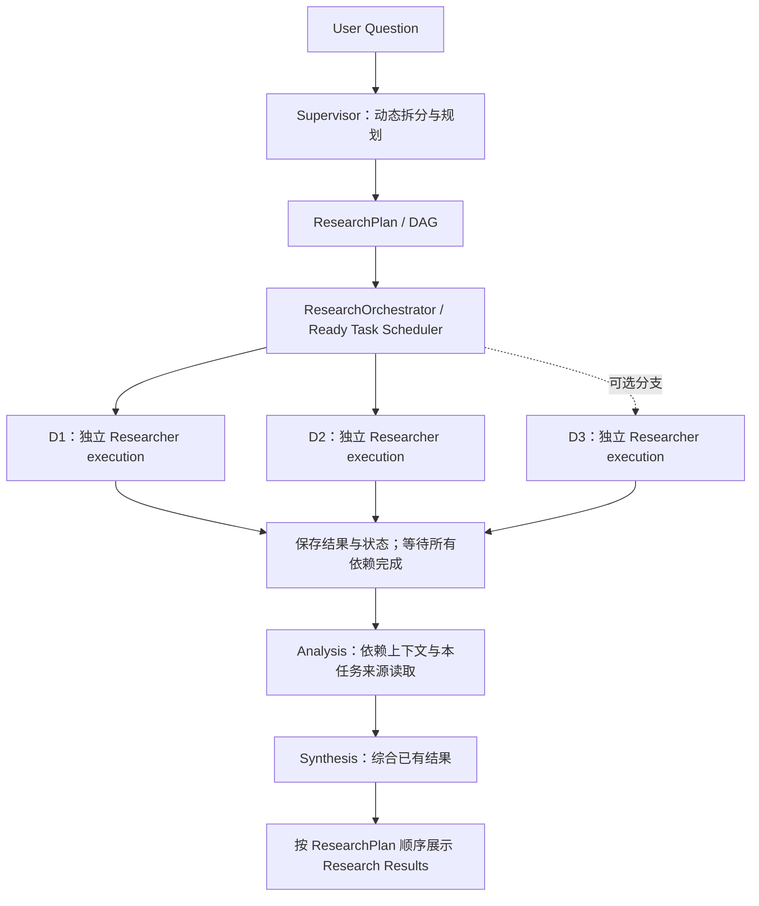
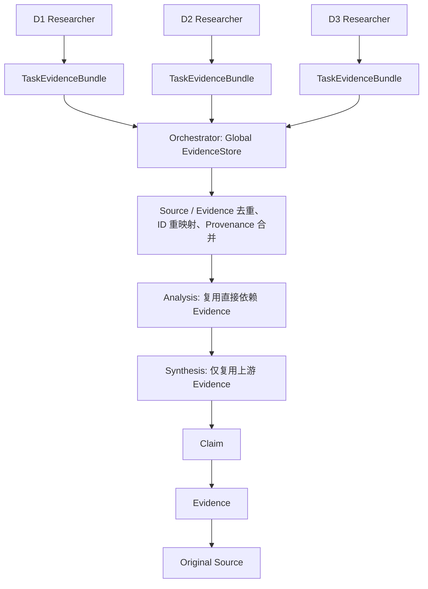

# DeepResearch Agent

## Overview / 项目概览

DeepResearch Agent 是一个面向证据驱动研究的命令行项目：将开放式问题规划为研究任务，搜索并读取外部来源，再经过分析与综合输出研究摘要。

当前已完成 **Phase 1 — Research 基础链路**、**Phase 2 — Parallel Research**、**Phase 3 — Evidence System**、**Phase 4 — Verifier Loop**、**Phase 5 — Writer + Citation**、**Phase 6 — Persistence / Checkpoint / Resume** 和 **Phase 7 — Evaluation & Benchmarking**。系统动态生成研究 DAG，并行研究，验证证据支持与目标相关性，在预算内补研究，最后用合格 Claim 生成结构化报告，再由程序生成编号引用和 References。CLI 默认把安全边界的 JSON 快照保存到 SQLite，支持按 Run ID 显式恢复；独立 Evaluation CLI 提供跨领域基准、指标向量及 Baseline 对比。

## Features / 当前能力

- 动态规划：根据问题选择互补的独立 discovery 子问题，生成并校验带依赖的 ResearchPlan。
- 并行研究：按批次执行依赖已满足的任务，使用可配置的并发上限控制 Researcher execution 数量。
- 搜索与读取：通过 Tavily 获取标题、URL 和短摘要，通过 HTTP 与 BeautifulSoup 读取 HTML 来源正文。
- 上下文隔离：每个任务创建独立 Agent、消息历史和 ToolBudget，接收依赖任务的压缩结果及有大小限制的 Claim/Evidence 来源链。
- 证据抽取：从实际成功读取的网页抽取原文片段，生成有 Evidence 引用的 Claim；任务局部 Bundle 由 Orchestrator 合并到运行级 Store。
- 多阶段输出：保留 discovery、analysis、synthesis 的职责，最终按计划顺序输出结果。
- 执行可观测性：记录任务 ID、工具与模型请求阶段、结果数量、耗时、等待进度及明确的失败原因。
- 证据报告：Writer 只读消费 `SUPPORTED + ALIGNED` Claim，发布前批量检查段落和标题是否被所引用的 Claim 支持；不通过时保守回退。正文保留 Claim → Evidence → Source 关联，分别统计写作与语义核验用量。
- 确定性引用：按最终报告正文首次使用 Source 的顺序分配 `[1][2]`，从 Store 元数据生成去重 References，完整性检查通过后才打印报告；citation 模型调用及输入/输出 tokens 均为 0。
- 持久化恢复：CLI 为研究生成 Run ID，以 SQLite 保存安全 JSON 快照；可按 ID 恢复并跳过已完成任务/阶段，保留证据 ID、去重状态和补研究预算。
- 外部评估：版本化跨领域 Benchmark、只读质量与效率指标、独立 Search-Summarize Baseline、可选单次 Judge，以及 JSONL/JSON/CSV 对比结果。

## Development Phases / 开发阶段

Phase 1 建立完整 Research 主链路；Phase 2 升级任务拆分与并行执行；Phase 3 建立可追溯、可复用的证据数据；Phase 4A 按 Task 批量验证证据支持，Phase 4B 批量判断目标相关性并生成缺口，Phase 4C 在预算内补研究并更新缺口状态；Phase 5A 将初始与补研究的合格结论组织为报告，5B 从正式 provenance 确定性渲染 citation 与 References。以下记录已完成阶段，并为后续阶段保留目标、范围与验收结构。

### Phase 1 — Research 基础链路

**Status: Completed**

#### 1. Goal / 阶段目标

将用户问题转化为可执行的研究计划，跑通“规划 → 获取资料 → 分析 → 综合 → 输出结果”的完整流程。重点是组件衔接、任务职责和依赖结果传递，执行方式为串行。

#### 2. Architecture / 组件职责

| 组件 | 职责 |
| --- | --- |
| Supervisor | 理解问题并生成研究计划，使用结构化输出或 JSON 回退解析；不负责搜索网页。 |
| ResearchPlan | 保存总体目标 `goal` 和任务列表 `tasks`，通过任务依赖表达研究流程。 |
| ResearchTask | 保存 `id`、`title`、`question`、`description`、`task_type`、`depends_on` 和 `status`。 |
| ResearchOrchestrator | 校验依赖，串行执行依赖已满足的任务，收集结果并更新任务状态。 |
| Researcher | 为当前任务创建独立 DeepAgent，根据任务类型使用工具，生成 Research Memo。 |
| web_search | 获取外部来源的标题、URL 与摘要；搜索结果作为研究线索，不直接生成研究总结。 |
| fetch_webpage | 读取 HTML 页面并提取标题、日期元数据和有限长度的正文。 |
| ToolBudget | 为每个任务单独限制搜索和网页读取次数。 |
| ResearchExecutionResult | 保存单任务的 `memo`、`compact` 和 `tools_used`。 |
| CompactResearchResult | 保存简短摘要、发现、来源与不确定信息，供依赖该任务的后续任务使用。 |
| ResearchResult | 汇总整个计划、各任务 Memo 和压缩结果，供调用者读取。 |

Phase 1 已有依赖字段和依赖校验，计划通常表现为 discovery → analysis → synthesis 的线性链路；这一阶段尚未实现多个任务同时执行。

#### 3. Workflow / 串行研究流程



这是典型流程；任务依赖由计划表达。任务间传递的是压缩结果，不包含前一个 Agent 的工具历史或整页正文。

#### 4. Task Types / 执行职责

| 类型 | 执行职责 | 信息来源 |
| --- | --- | --- |
| `discovery` | 主动搜索新的外部资料，读取重要来源，为后续研究提供发现与来源线索。 | `web_search`、`fetch_webpage`，以及需要时的依赖上下文。 |
| `analysis` | 根据前置结果深入读取相关来源，分析方法、贡献、实验结果、差异或局限；资料不足时可补充搜索。 | 依赖任务的 CompactResearchResult 与本任务读取的来源正文。 |
| `synthesis` | 比较并整合已有发现，形成共识、差异和信息缺口；通常不重新搜索，明确缺口时可在预算内补充。 | 前置任务的压缩结果。 |

这三类任务的职责在 Phase 2 中延续。Phase 1 的来源读取由 Agent 根据提示调用工具，程序在缺少必要调用时提醒并检查；后续的程序预读机制见 Phase 2 的稳定性补充。

#### 5. Result / 阶段成果

Phase 1 已具备问题规划、任务拆分、依赖校验、搜索工具调用、HTML 网页读取、独立任务预算、多阶段 Research Pipeline，以及结构化结果传递能力。

给用户的 Memo 默认使用简体中文，包含“研究任务”“主要发现”“重要来源”“不确定性与缺失信息”四部分。来源条目要求尽量提供标题、URL、可确认的年份或日期、相关性及关键点；未知年份应标为 `unknown`。Markdown 规则从 Memo 提取压缩结果，并对来源标题进行轻量去重。

### Phase 2 — Parallel Research

**Status: Completed**

#### 1. Goal / 阶段目标

在 Phase 1 的 Research 主链路上增加 **Task Decomposition + 独立 Researcher executions + Parallel Research**：先将问题拆为研究 DAG，再并行执行没有前置依赖或依赖已完成的任务。

本项目当前的“SubAgents”能力体现为 Orchestrator 为多个任务分别启动独立 Researcher execution。每次 execution 创建自己的 DeepAgent。当前代码使用 `subagents=[]`，并关闭默认 general-purpose subagent，没有启用 DeepAgents 内部的嵌套子代理或代理间 handoff。

#### 2. What Changed from Phase 1 / 相对 Phase 1 的变化

| 能力 | Phase 1 | Phase 2 |
| --- | --- | --- |
| 任务拆分 | 通常是一条 discovery → analysis → synthesis 链路。 | 根据问题动态生成多个互补、无依赖的 discovery 分支，再分析与综合。 |
| 规划过程 | 直接请求模型生成计划。 | 先识别独立搜索子问题，再生成并校验 ResearchPlan。 |
| 任务数量 | Supervisor 校验 3～6 项任务。 | Supervisor 校验 2～6 项任务，允许简单问题采用 discovery → synthesis。 |
| 计划结构 | 已有依赖字段与 DAG 校验，但常见计划偏线性。 | 显式支持多个独立分支汇合的 Research DAG。 |
| 执行方式 | 就绪任务逐个串行执行。 | 每批选择最多 `max_concurrency` 个就绪任务，同时执行。 |
| Researcher 状态 | 各任务已有独立 Agent 和预算，但同一时间只执行一个。 | 多个独立 execution 同时运行，分别持有消息、预算和依赖结果副本。 |
| 依赖处理 | 依赖结果存在后串行执行下游任务。 | 必须同时满足依赖状态为 `completed` 且结果已保存，才允许进入执行批次。 |
| 并发配置 | 没有并行执行上限参数。 | Orchestrator 构造参数 `max_concurrency`，默认值为 3。 |
| 执行与展示顺序 | 串行执行并打印结果。 | 任务按允许的依赖并行执行，最终结果仍按原始计划顺序输出。 |
| 失败处理 | 当前任务失败后终止流程。 | 等待当前批次收齐结果，保留并展示成功任务，报告失败及未执行任务，停止后续调度。 |

搜索后端切换、analysis 来源预读、超时与进度日志是随后补充的稳定性修复，下面单独说明；它们不属于 DAG 调度本身。

#### 3. Phase 2A — Task Decomposition Upgrade

Supervisor 使用同一个模型完成两步规划：

1. 读取 [decomposition.md](app/prompts/decomposition.md)，根据当前问题识别可独立搜索的互补子问题。
2. 将这些子问题与原始目标、当前日期交给 [supervisor.md](app/prompts/supervisor.md)，生成 ResearchPlan。

子问题数量由研究范围决定，通常选择 2～3 个，最多 4 个；这不是固定领域模板。提示要求每个子问题保留原始问题的完整核心主题、限定对象和时间范围，合并重复或包含关系明显的分支，不把“找论文”和“找综述”等来源体裁当成互补维度。

生成的计划由 Supervisor 校验：

- 总任务数为 2～6；每个任务必须显式提供 `task_type`，初始状态为 `pending`。
- discovery 必须满足 `depends_on=[]`；analysis 和 synthesis 必须依赖已有任务。
- 任务 ID 唯一，依赖不能重复、自引用、指向不存在的任务或形成循环。

典型结构为 D1、D2（必要时增加其他 discovery）→ A → S。简单问题也可以直接使用 discovery → synthesis，不要求固定五个任务。

Phase 2A 当时保留串行 Orchestrator，只升级规划与必要的 schema 描述；真正并行执行由 Phase 2B 引入。主题保持与分支互补由提示约束，当前尚无独立的语义质量验证器。

#### 4. Phase 2B — Parallel Execution

[ResearchOrchestrator](app/research/orchestrator.py) 使用批次式 DAG 调度：

1. 校验计划与初始任务状态。
2. 找出状态为 `pending`、所有依赖已 `completed` 且执行结果已保存的 ready tasks。
3. 按计划顺序选择最多 `max_concurrency` 个任务，置为 `running`。
4. 使用 `asyncio.gather(..., return_exceptions=True)` 并行等待这一批；同步 `Researcher.research()` 通过 `asyncio.to_thread()` 接入。
5. 收集成功结果，任务置为 `completed`；异常任务置为 `failed`，然后判断是否继续下一批。

批次大小直接限制并发数量，当前没有使用 Semaphore。即使某个任务先完成，也要等这一批全部返回后才重新计算 ready tasks。调度器支持依赖允许的任务并行，并不只针对 discovery；生成计划通常将独立 discovery 安排在第一批。

下游任务必须等待其 `depends_on` 中的全部任务完成。例如 A 依赖 D1、D2，S 依赖 A，则 A 不能在 D2 尚未完成时开始，S 也不能在 A 尚未完成时开始。

每个 execution 创建独立 Agent、消息历史、当前任务请求和 ToolBudget。传入的依赖 CompactResearchResult 使用深拷贝，任务间继续通过压缩结果传递信息，不共享前序 Agent 的原始消息。

失败处理保持简单：任一任务失败时，等待当前批次返回、展示成功任务的 Memo、列出失败原因和仍未执行的任务，随后终止运行。当前不继续调度其他批次，也不自动重规划或重跑研究。若仍有 pending tasks 却没有 ready tasks，则明确报错，避免调度循环无限等待。

**后续稳定性补充：**

- 搜索从原来的 DDGS 切换到 Tavily API，保持 `web_search(query, max_results)` 及标题、URL、摘要返回格式；认证、限流、配额、超时和异常结果格式均明确报错。
- Phase 2 中，analysis 的压缩依赖上下文包含 URL 时，程序在模型执行前预读来源，优先交错选择不同依赖任务的来源，目标为最多 2 个可读页面。失败时在原有 3 次读取预算内尝试其他候选；非空正文才作为有效读取结果。Phase 3C 已在存在可用上游 Claim/Evidence 时改为优先复用，保留无结构化证据时的预读。
- 预读与模型后续调用共享同一个预算。成功正文和读取失败原因仅进入当前任务请求；全部来源不可读则明确失败，部分不可读则要求模型说明证据缺口。
- 普通模型请求默认配置 60 秒 HTTP 超时、0 次自动重试；Phase 3B 证据抽取使用独立的 120 秒请求时限。每项 Researcher 任务默认有 300 秒总时间预算，等待时每 15 秒输出阶段和耗时。任务超时后禁止新的工具与模型调用，丢弃迟到结果；已经发出的同步请求按底层超时收尾，不强行终止线程。

#### 5. Parallel Research Workflow / 并行工作流



图中分支数是示意，实际数量来自 Supervisor 生成的计划；并发上限不要求每批必须填满。

#### 6. Example / 真实运行案例

问题：`调研 sparse reward offline reinforcement learning 的最新研究进展`

一次实际运行生成了以下计划：

| ID | 类型 | 子任务 | 依赖 |
| --- | --- | --- | --- |
| D1 | discovery | sparse reward offline reinforcement learning 在 Atari 游戏上的研究进展 | 无 |
| D2 | discovery | sparse reward offline reinforcement learning 在连续控制任务中的研究进展 | 无 |
| A | analysis | 分析两个方向的已有研究结果 | D1、D2 |
| S | synthesis | 综合总体研究进展 | A |

执行批次为：

```text
Batch 1：D1 + D2 并行执行
Batch 2：A，等待 D1、D2 都完成后开始
Batch 3：S，等待 A 完成后开始
最终展示：D1 → D2 → A → S
```

该次日志中 D1、D2 的工具与模型请求交错出现，A 实际预读 2 个来源，S 未调用 Web，四个任务均完成。此案例验证规划与调度流程；子任务划分是当次模型生成的结果，研究摘要中的年份、主题相关性及论断仍需核验。

#### 7. Result / 阶段成果

Phase 2 新增了动态 discovery 分支拆分、两步规划、宽 DAG、独立 Researcher execution 的并行运行、依赖感知调度、可配置并发上限，以及并发场景下的状态管理、依赖结果隔离和稳定结果展示。

已有 pytest 覆盖多个独立任务重叠执行、超过并发上限时分批、下游等待全部依赖、失败批次结束、结果顺序、状态隔离，以及来源预读和超时处理。Phase 2 的完成范围是规划与执行链路，尚不代表研究内容已经经过事实验证。

### Phase 3 — Evidence System

**Status: Completed**

- **Goal / 目标：** 将研究来源与发现整理为可追溯的证据数据。
- **Planned Scope / 计划范围：** Source、Evidence、Claim、Evidence Store，以及来源与论断之间的关联。
- **Completion Criteria / 预期验收：** 可以按研究任务和论断保存、检索证据，并回溯对应来源。

**Phase 3A — Evidence System Foundation：** 已实现 Source、Evidence、Claim、TaskEvidenceBundle 和内存 EvidenceStore，支持 URL 去重、引用完整性检查、原子合并及 Claim → Evidence → Source 查询。静态 Demo：`python demo_evidence.py`，无需 LLM 或网络。

**Phase 3B — Researcher Evidence Extraction：** Researcher 在研究结束后调用按当前候选构建的 JSON Schema，并使用 Pydantic 校验结果，选择原文候选片段并生成关联结论；不支持原生 JSON Schema 的服务使用一次 JSON 兼容回退并校验。程序将成功读取页面中的单句及相邻句组合提供为候选，保留一个完整机制或事实，并将新片段与上游 Evidence 统一编号。模型只选择候选及 Claim 支持关系，程序直接复制原文或复用已有 Evidence。Source 仅登记被选作证据的成功读取页面，不登记所有搜索候选。片段与引用校验只检查抽取来源，不判断 Claim 是否得到充分支持；每个正式 Claim 必须至少引用一条 Evidence，内部 ID 全部由程序生成。

Discovery 返回局部 Bundle；ResearchExecutionResult 同时携带 Memo 和 Bundle（兼容字段默认仍为 `None`），ResearchResult 提供运行级 `evidence_store` 与任务级 `evidence_bundles`。Orchestrator 在批次返回后统一 merge；Researcher 只接收只读快照，不直接写 Global Store。CLI 默认显示数量统计，`SHOW_EVIDENCE_DEBUG=true` 可额外显示 Claim → Evidence → Source 内容及 provenance。

**Phase 3C — Cross-Task Evidence Aggregation and Reuse：**

- 单次运行共用一个 Global EvidenceStore。Source 按规范化 URL 去重；移除 fragment、尾斜杠、默认端口，统一主机大小写。已知 arXiv `abs/html/pdf` 表示共用论文身份，保留明确的 `v1/v2`、查询参数与原始读取 URL；不做联网 canonical 解析。PDF 只参与身份匹配，读取工具仍不解析 PDF。
- Evidence 仅在 **相同 canonical Source + 空白规范化后完全相同的原文** 时去重；大小写和标点保留，不做语义合并。保留第一条 Evidence 的 ID、正文、location 和提取任务；Claim 不按文本去重。
- 合并事务同时维护 Source/Evidence 本地 ID 别名、canonical 引用、provenance 及反向索引：先重映射 `Evidence.source_id`，再重映射并去重 `Claim.evidence_ids`。任一引用或 ID 冲突使整次 merge 回滚。返回 Bundle 的 Evidence 只包含本任务最初提取的 canonical 片段；跨任务复用直接体现在 Claim 引用中，不复制片段。
- `Source.task_id` 始终表示首次发现任务，可通过只读属性 `discovered_by_task` 访问；`Evidence.task_id` 始终表示首次提取任务，可通过 `extracted_by_task` 访问。后续使用任务由 Store 的普通索引记录，`get_source_provenance()` / `get_evidence_provenance()` 返回不可变的 `used_by_tasks`，后者还提供 `referenced_by_claim_ids` 与 `is_cited`。这些元数据由 Store 根据实际合并和 Claim 引用更新，不引入可互相冲突的多个来源任务字段。
- Analysis 优先复用上游 Claim 和原文 Evidence，不强制重复预读；缺少具体细节时仍可使用现有搜索/读取预算。当没有可用结构化证据、只有来源 URL 时，保留 Phase 2 来源预读行为。这不是自动 Gap Detection 或 Re-Research。
- Synthesis 不注册 Web 工具，预算为 0/0；抽取只接受已有 upstream Evidence，不创建新 Source/Evidence。缺少 Evidence 的发现保留在 Memo 不确定性中，不产生无证据的正式 Claim。
- `build_evidence_context(task, store)` 默认选择 direct dependencies 的 Claims；Orchestrator 为 Synthesis 显式加入依赖链上的祖先任务，补充中间阶段可能遗漏的 discovery 维度。沿引用取得完整 Evidence 与 Source metadata，继承的 Evidence 保留原 ID。按任务交错选择完整支持链，最多 12,000 字符、12 Claims、24 Evidence；不能容纳的整组跳过，不截断单条支持链。不发送无关任务、完整 Store、页面正文或未引用片段。
- 未引用 Evidence 保留，避免提前删除潜在信息；通过 `is_cited` 和 `get_cited_evidence()` 区分已引用片段，默认不进入下游 context。每次 merge 打印新增/去重数量及 Claim 复用数量；最终 `source_reuse/evidence_reuse` 统计额外的不同任务使用关系，同一任务重复 merge 不重复计数。

Store 查询 API：

| 查询 | 接口 |
| --- | --- |
| 单个记录与支持链 | `get_claim`、`get_evidence`、`get_source`、`get_evidence_for_claim`、`get_source_for_evidence`、`get_sources_for_claim` |
| 按任务查询 | `get_claims_for_task`、`get_evidence_for_task`、`get_sources_for_task`；后两者包含本任务首次登记及跨任务实际使用的记录 |
| provenance 与引用状态 | `get_source_provenance`、`get_evidence_provenance`、`get_cited_evidence` |
| 反向引用 | `get_claims_using_evidence`、`get_evidence_from_source` |

Phase 3B extraction prompt、Schema 策略、输出额度及两阶段恢复规则保持不变：首轮 6 Claims / 160 字符 / 4 refs，截断恢复 3 / 90 / 3，额度翻倍且继续遵守现有 8,192 token 上限（默认 6,144 → 8,192）。未实现 Verifier、Citation 或 Persistence。

**Discovery 读取失败与 Memo 稳定性修复：**

- 成功读取要求真实、非空的 HTML 文本；调用过 `fetch_webpage`、搜索摘要或 PDF 失败响应都不算读取成功。
- 已知 arXiv/PMLR/OpenReview PDF 链接转为对应 HTML/摘要页，返回实际页面 URL、标题及可确认日期；不下载解析 PDF，不为普通网站猜测 HTML URL。每次工具调用最多尝试两次 HTTP 请求，继续遵守任务截止时间和原有读取次数预算。
- Discovery 无成功读取时最多追加一次 Agent 读取提醒；仍失败则按已返回的搜索 URL/已尝试 URL 继续读取替代页面或其他候选，避免重读已失败的内部替代页面，不使用 Memo 自造的链接。读取预算耗尽即停止；应用补读成功时仅重新生成一次 Memo，再调用原有 extraction。
- Discovery、Analysis、Synthesis 最终展示均由正式 Claim 重建，来源标题、URL、日期从关联 Source 直接读取。报告中的证据编号关联实际 Evidence 摘录预览，完整内容保留在 Store。自由生成的草稿仅用于引导抽取，不直接成为公开发现或下游结论；无正式 Claim 时只报告缺口。
- Synthesis 可以复用整个依赖链上的正式 Claim 和 Evidence，避免 discovery 的研究维度因中间 analysis 选择性抽取而完全消失；不读取无关任务。按任务轮询保留完整引用链，日志输出已覆盖/可用任务与 Claim 数，显式报告未覆盖分支。
- 模型请求前移除预算耗尽的搜索/读取工具，并注入当前剩余额度。模型仍返回已隐藏工具或超额并行调用时，在响应端拦截，避免进入工具执行；仅剩被拦截调用时结束 Agent pass，使用已有材料走原有的一次无工具 Memo 收尾。并行工具调用以锁保护额度预留，实际调用总数仍受原有上限约束。
- PMLR、alphaXiv、OpenReview 论文页、NeurIPS/ICLR 论文海报页及 Springer 论文页识别为 `paper`，不再仅识别 arXiv。分类表示论文来源页面，不表示已读取 PDF 或全文。
- 全部读取失败或没有正式 Claim 时，本分支只输出明确缺口，`compact.key_findings/sources` 为空，便于其余分支继续执行。此时 `completed` 表示执行结束，日志另标记 `discovery incomplete` / `coverage gap`；不表示已找到研究结论。
- 这些措施控制读取与输出 provenance，不判断 Evidence 在语义上是否支持 Claim；抽取模型仍可能判断错误，证据支持关系由 Phase 4A 独立验证，仍不等于现实世界事实已核实。

**验收：** 全部 287 项离线测试通过（含 21 项 Phase 3C 测试及 Phase 2 并行、Phase 3B fallback 回归）。真实 CLI 对原始 sparse reward offline RL 查询运行成功；另一次真实验收运行随机检查 Discovery / Analysis / Synthesis 各一个 Claim，全部 44 条正式引用均为 canonical ID、来源可查询、provenance 一致，Synthesis 局部 Source/Evidence 均为 0。该轮 Store 为 Sources=1、Evidence=12、Claims=11、Source reuse=2、Evidence reuse=16；D1 返回空 Bundle，跨层支持主要来自 D2，D1+D2 多来源共同支持的情况另由单测覆盖。这些计数取决于模型和搜索结果，不是固定数量或内容质量保证。



### Phase 4 — Verifier Loop

**Status: Completed**

- **Goal / 目标：** 对研究结果进行验证，并围绕具体缺口补充研究。
- **Planned Scope / 计划范围：** Research → Verify → Gap → Re-Research 的反馈循环。
- **Completion Criteria / 预期验收：** 能识别缺少支持或存在冲突的论断，生成补充任务，并保留验证依据。

**Phase 4A — Token-Efficient Batch Claim Verification：Completed**

- 每批 Researcher 仍按 Phase 2 并行执行；成功 Bundle 统一 merge 到 Global EvidenceStore 后，按 Task 串行批量验证。默认每 Task 最多 6 条 Claim 一次调用，不按 Claim 单独调用；空任务跳过。
- [ClaimVerifier](app/agents/verifier.py) 直接调用无工具的模型，不创建搜索 Agent。独立 [verifier prompt](app/prompts/verifier.md) 只判断当前引用证据的相关性、直接支持、范围、强度、比较及实验条件，不用模型先验知识补全。
- [Compact context builder](app/research/verification_context.py) 只按 Claim 的 `evidence_ids` 查询正式 Evidence 及最少 Source 元数据（title、url、source_type）。同一 batch 的 Evidence 正文与 Source 元数据各传一次，Claim 只保留引用；不传 Memo、dependency memo、搜索结果、网页全文或整个 Store。A/S 可以引用 D1/D2 等上游 Evidence，不要求同任务来源。
- `MAX_VERIFY_CLAIMS_PER_BATCH=6`，`MAX_VERIFICATION_CONTEXT_CHARS=18000`。字符额度指 compact 数据 JSON（不含固定系统提示和 Schema）。按数量和长度贪心拆批；不删除 Claim、不删引用、不截断 Evidence。单个完整支持链仍超预算时，在任何 API 请求之前明确报错，需调整预算。
- 模型只输出 `claim_id/status/reason`，reason 最多 400 字符。输入中的 Claim 使用批内 `C1/C2` 短标签，动态 Schema 限定可选标签，程序验证完整集合后映射回正式 Claim ID，减少 token 与长 UUID 抄写错误。状态仅 `SUPPORTED`、`PARTIAL`、`UNSUPPORTED`，分别表示完整支持、较弱/部分支持、无核心支持或矛盾；不是 TRUE/FALSE 或置信分数。模型返回漏项、重复/陌生标签、非法状态或恢复后仍超长的 reason 时拒绝整项任务的验证结果，不伪造状态。
- 程序预检查：无引用的 legacy/debug Claim 直接 `UNSUPPORTED`，不调用模型；正式 Phase 3 Claim 仍要求至少一个 Evidence。未知 Evidence/Source 直接报引用完整性错误。默认先检查全部拆批，再调用模型。
- 优先原生 JSON Schema；服务明确不支持时，最多切换一次纯 JSON + Pydantic 校验，并在本 Verifier 实例中记住不支持，后续 batch 不重复探测。百炼 Qwen3.5 直接走 JSON Object；仅字段结构校验失败允许当前 batch 重新生成一次完整结果，超长 reason 也属于此类，不删坏行、不截断 reason、不重跑已经有效的 batch。纠正请求使用原有完整证据，计入实际调用和补研究预算，并共享验证阶段截止时间；第二次仍不合格则明确失败。未知/遗漏/重复 ID、Schema 回显、截断、超时和服务错误不触发此纠正。模型客户端自动重试为 0。
- `VERIFICATION_MAX_TOKENS=3072` 限制每次输出；每任务验证总时限 `VERIFICATION_TIMEOUT_SECONDS=120`，单次 HTTP 请求还受 `MODEL_REQUEST_TIMEOUT_SECONDS` 与剩余时限约束。通过回调收集 provider 提供的 token usage，不修改共享 Researcher 模型的请求参数。
- 可单独设置 `VERIFIER_MODEL_NAME`；不设置时使用 `MODEL_NAME`。`VERIFIER_MODEL_API_KEY` 和 `VERIFIER_MODEL_BASE_URL` 必须成对设置，否则继承研究服务的完整凭据。支持思考开关的百炼 Qwen 默认在 verifier 工厂中设置 `enable_thinking=false`，其他 provider 不附加此参数。
- [VerificationResult](app/schemas/verification.py) 包含程序生成的 `verification_id`、`claim_id`、`task_id`、`status`、`reason`、原 Claim 的 `evidence_ids`，与 Claim 分离。[VerificationStore](app/research/verification_store.py) 保留同一 Claim 的多次结果，提供 add、latest、按 Claim/Task 查询；不覆盖历史。暂不实现跨请求 fingerprint 缓存，同一 batch 的重复 Claim ID 只验证一次。
- `ResearchResult.verification_store` 和 `verification_usage` 暴露结果及效率统计。CLI 显示每批 claims、unique_evidence、context_chars、calls，以及任务和运行级状态汇总。运行级 context_chars 累计实际请求的数据 JSON 长度，兼容回退的重复传输也计入。默认不逐条输出 reason；`SHOW_VERIFICATION_DEBUG=true` 可显示。usage 可用时显示输入/输出 token 数及有 usage 的响应数，不能将缺失 usage 当作零 token 消耗。
- `PARTIAL/UNSUPPORTED` 不删除 Claim、不改 Memo、不影响下游 Evidence 复用。验证请求/数据错误会明确失败并停止后续批次，保留并展示已完成研究 Memo；不会把 API 故障登记为 `UNSUPPORTED`。离线 Phase 2/3 单测可通过 `ResearchOrchestrator(..., verify_claims=False)` 隔离验证层，CLI 默认开启。

流程：Research → merge canonical Bundle → 按 Task 构造 cited-evidence batch → Verify → 保存独立结果。Phase 4A 到此停止。

**Phase 4A 验收：** 全部 387 项离线测试通过（既有 345 项回归 + 新增 42 项）。使用当前 SiliconFlow `Qwen/Qwen2.5-7B-Instruct` 运行原始 sparse reward offline RL 问题成功：D1/D2 并行，A/S 复用上游证据；10 条 Claim 共 4 次验证调用，SUPPORTED=6、PARTIAL=2、UNSUPPORTED=2，累计 compact context=29,117 字符，验证专属输入/输出 token 为 10,614/340。另一次真实合成语义样例以 1 次调用验证 4 条 Claim，覆盖直接支持、范围扩大、无关机制和无比较证据。计数与判断依赖本次模型及资料，不代表固定输出或事实准确率。

**Phase 4B — Token-Efficient Gap Detection and Research Relevance：Completed**

- 新增独立 [RelevanceAssessor](app/agents/relevance.py) 与 [relevance prompt](app/prompts/relevance.md)。全局研究和 Phase 4A 验证完成后，收集全部 Task 的正式 Claims（包括 Analysis/Synthesis），尽量一次批量判断；不逐 Claim 调用，也不逐 Task 重复判断。
- 输入为原始用户 query（直接传递，不让模型重写）、相关 Task 的 title/question/description，以及 Claim 的批内短标签、task_id、完整 text。每批 Goal 和 Task 目标只传一次；不传 Evidence、Source、引用 ID、网页全文、Research Memo 或 dependency memo。模型只做目标相关性判断，不重复执行 Evidence → Claim 支持验证。
- `RelevanceStatus` 仅 `ALIGNED / PARTIAL / MISALIGNED`：分别表示直接帮助回答全局目标及本 Task 核心问题、背景/边缘相关或缺少重要条件、研究对象/设置/目标明显偏离。共享关键词或大领域不足以判 ALIGNED，不从 Task 标题自动补全 Claim 缺失的条件；生产代码与提示无当前测试主题的关键词规则。Claim 未包含来源日期时，本层不臆测时效性。
- [ClaimRelevanceResult](app/schemas/relevance.py) 与 VerificationResult 分离，包含程序生成的 `relevance_id`、正式 `claim_id`、`task_id`、`status`、`reason`（最多 320 字符）。模型仅输出批内 `claim_id/status/reason`，程序验证完整标签集合后映射回正式 ID；不输出查询、论文建议、计划或置信分数。
- `MAX_RELEVANCE_CLAIMS_PER_BATCH=12`、`MAX_RELEVANCE_CONTEXT_CHARS=12000`（数据 JSON，不含固定系统提示/Schema）。数量或字符超限就拆批，不截断 Claim、Goal 或 Task 核心目标；单条仍超预算时请求前明确报错。空 Claim 集合不初始化模型、不调用 API。
- 沿用已验证的原生 JSON Schema → 服务明确不支持时纯 JSON + Pydantic 兼容路径，最多一次能力回退并记住结果。仅模型请求超时允许当前 batch 重试一次，保留本次 pass 已完成的 batch，不重跑 Researcher 或 Verification；原生和 JSON 兼容路径共用这一次超时重试额度。Reason 超长、漏项、重复/陌生 ID、非法状态、截断、鉴权/限流/连接错误直接失败；二次请求超时或阶段总预算耗尽也明确失败，不发布部分 relevance/gaps，不将失败伪造成 MISALIGNED。
- Relevance 复用独立 verifier 模型工厂及 `VERIFIER_MODEL_*` 配置，默认继承当前研究模型，支持的百炼 Qwen 默认关闭思考。`RELEVANCE_MAX_TOKENS=3072` 限制每次输出，`RELEVANCE_TIMEOUT_SECONDS=180` 是整个 relevance pass（所有 batch、兼容回退和超时重试）的总预算。首次尝试的请求时限为 `min(MODEL_REQUEST_TIMEOUT_SECONDS, 剩余时间 / 2)`，为唯一一次重试预留时间；重试请求受模型请求时限和当时全部剩余时间约束，总截止时间不重置。补研究内每次重试照常计入共享调用预算，预算耗尽后不发送请求。Phase 4A ClaimVerifier、VerificationStatus、Prompt 和抽取逻辑保持不变。
- [GapDetector](app/research/gap_detection.py) 消费最新 VerificationResult 与 relevance 结果，用纯程序规则生成 [ResearchGap](app/schemas/gap.py)。每条 Claim 的支持结果必须存在并与 task/Claim/引用匹配，缺失或陈旧结果在 relevance 调用前报数据完整性错误；不重复做支持语义检查。
- GapType 仅三类：Verification 为 PARTIAL/UNSUPPORTED → `SUPPORT_GAP`；Relevance 为 PARTIAL/MISALIGNED → `RELEVANCE_GAP`；Task 没有任何 `SUPPORTED + ALIGNED` Claim → `COVERAGE_GAP`。同一 Claim 可以同时有 support/relevance gap；SUPPORTED 但 MISALIGNED 仍有 relevance gap。一个有效 Claim 即满足当前最小 Task coverage 条件，这不代表该维度已经全面覆盖。
- 无 Claim 的 Task 直接生成一个 COVERAGE_GAP，不为该 Task 调用 relevance 模型；有多个无效 Claim 也只生成一个 Task coverage gap。支持缺口和 coverage 计算各新增 **0 次 LLM 调用**；主要新增成本只有 run-wide relevance batch（典型 10 Claims 约 1 次，超预算拆批或服务兼容回退可能增加）。
- ResearchGap 字段为 `gap_id/gap_type/task_id/claim_id/description/missing_information`。gap_id 由程序生成，coverage 的 claim_id 为 None，其余必须绑定 Claim。description/missing_information 使用既有 verifier/relevance reason 及 Task 目标程序生成，说明缺少什么信息，不生成 search query 或 ResearchTask。
- [GapStore](app/research/gap_store.py) 提供 `add_gap/get_gap/get_gaps_for_task/get_gaps_for_claim/get_gaps_by_type/all_gaps`。按 `(task_id, claim_id, gap_type)` 去重，重复键保留首条；每 Task 至多一条 coverage gap。Phase 4C 追加 `update_status`，不做 embedding 去重。
- `ResearchResult` 新增 `relevance_results`、`relevance_usage`、`gap_store`。CLI 保留 Evidence Store 与 Verification Summary，新增独立 Relevance Summary、Gap Summary；默认不逐条显示 Gap，`SHOW_GAP_DEBUG=true` 可显示全部字段。请求发出前记录 `relevance batch i/n`、claims/tasks/context_chars、`retry=0/1` 或 `1/1`、request_timeout 和 remaining；等待日志也包含批次编号。完成后记录实际 calls 和可获得的 token usage；运行级字符统计包含兼容回退及重试的重复传输，batches 不重复计数。
- 不改写 Memo、不删除任何 Claim、不改变 Phase 2 调度或 Phase 3 Evidence 复用。`ResearchOrchestrator(..., detect_gaps=False)` 可隔离 4B；关闭 `verify_claims` 时默认同时关闭 gap pass。正常 CLI 默认开启两层。Researcher/Verifier 硬失败仍沿用原停止规则；已经完成但没有 Claim 的任务由本层正常报告 coverage 缺口。Relevance 失败时展示已完成研究/verification 并明确失败，不输出伪造 Gap Summary。

Phase 4B 流程：Research → Verify → Detect Gap；默认 CLI 继续进入下面的预算补研究阶段。

**Phase 4B 验收：** 全部 437 项离线测试通过（既有 387 项回归 + 新增 50 项）。当前 Qwen2.5 运行原始问题成功，18 条 Claim 的 verification 为 SUPPORTED=15、PARTIAL=3、UNSUPPORTED=0，共 5 次调用；relevance 为 ALIGNED=5、PARTIAL=11、MISALIGNED=2，按 12+6 拆成 2 次调用，数据上下文累计 2,663 字符，输入/输出 token 为 1,928/336。Gap 为 support=3、relevance=13、coverage=2，总计 18。另以合成的 SUPPORTED 状态搭配真实 relevance 调用复测此前的偏题 Claim，识别为 MISALIGNED，并生成对应 relevance/coverage gap；该样例不冒充真实研究 Evidence。计数与判断不是固定输出或准确率保证。

**4B 稳定性修复验收（2026-10-12）：** 新增 13 项回归用例（含参数化扩展），全量 625 项测试通过。使用真实 ChatOpenAI SDK 与 HTTP 模拟复现 15 条 Claim 按 12+3 分批、第二批超时后恢复：只重试第二批，总调用数 3，第一批不重跑。另覆盖二次超时、重试后结果无效、阶段总预算耗尽、为重试预留时间、每批独立重试额度、原生与 JSON 兼容路径共享重试额度、补研究调用预算，以及鉴权/限流/连接/截断不重试。默认流水线集成测试确认恢复后 Researcher 和 Verification 各只执行原有次数；Phase 5 既有测试继续通过。本次没有重新执行线上全流程研究。

**Phase 4C — Budgeted Gap-Driven Re-Research：Completed**

完整流程：Research → Verify → Gap → Budgeted Re-Research → Verify Again → 新 Claim Relevance → 更新选中 Gap → STOP。

- [GapGroup / Selection](app/research/reresearch.py) 先按原 `task_id` 合并未解决缺口，再按 `COVERAGE_GAP > RELEVANCE_GAP > SUPPORT_GAP` 排序，同优先级保留原任务顺序。每个原任务最多选一组，每组默认最多携带 4 条缺口，每轮默认最多 2 组。未选中的 Gap 保持原状态；不会一个 Gap 生成一个任务。
- [ReResearchPlanner](app/agents/reresearch_planner.py) 使用便宜的 verifier 模型工厂，一次 batch 生成所有选中组的补充任务。输入只有原目标、原任务 title/description、gap types、少量 missing_information 和关联 Claim 文本，不传 Memo、网页或 EvidenceStore。数据 JSON 默认最多 12000 字符，输出最多 3072 token，总规划时限 60 秒。
- 模型只返回 `group_id/title/description`；程序生成 `ReResearchPlan(round_id, selected_gap_ids, tasks)`，以及轻量 `ReResearchTask(ResearchTask)` 的 ID、`origin_task_id/origin_gap_ids`。全部为无依赖 discovery，搜索 query 仍由 Researcher 决定。Planner 不重建原计划，原 DAG 不追加节点。
- 补研究复用原 Researcher 和 `gather/to_thread` 并行机制，继续受 `max_concurrency` 限制。ToolBudget 从集中配置读取，默认每任务 `web_search <= 2`、`fetch_webpage <= 2`。补研究保留原研究时限和抽取上限。
- 新 Source/Evidence/Claim merge 到本次运行的同一个 Global EvidenceStore，继续按 canonical Source/Evidence 去重、重映射 ID 并保留 provenance。新 Claim 用 `RR_<原任务>_1` 的 task_id 追踪轮次，不改变 Claim 数据模型或旧 Claim.evidence_ids。
- 仅对新 Claim 做 verification，之后仅对成功完成 verification 的新 Claim 做一次批量 relevance pass；不重复判断旧 Claim。结果仍保存在同一 VerificationStore 与 relevance_results 中。
- 只更新选中 Gap 的状态，保留 gap_id 和原描述。新 Claim 有至少一个 `SUPPORTED + ALIGNED` 时整组选中 Gap 近似标记 `RESOLVED`；support 为 SUPPORTED/PARTIAL 且 relevance 为 ALIGNED/PARTIAL、但没有同时完全满足时标记 `IMPROVED`；无 Claim、未验证、UNSUPPORTED 或 MISALIGNED 时保持 `OPEN`。这是一组级近似规则，不代表每条历史 Claim 已被修正或事实彻底核实。
- 默认 `MAX_RERESEARCH_ROUNDS=1`，当前版本只接受 0（关闭）或 1；无论是否还存在 OPEN Gap 都不会进入第二轮。`MAX_RERESEARCH_TASKS_PER_ROUND=2`、`MAX_RERESEARCH_LLM_CALLS=12` 控制额外工作量。
- [共享调用预算](app/research/reresearch_budget.py) 线程安全，统计 Planner、Researcher、Evidence Extraction、Verification、Relevance 的补研究模型请求；原始研究不计入。原生 Schema 被服务拒绝后的兼容调用及抽取恢复也计数。超额请求在发送前拦截，输出 `budget exhausted`，不生成替代任务或重跑原研究。已在执行的同步请求按自身时限收尾，迟到结果不用于 Gap 改善。
- 补研究阶段失败不会丢弃已完成的初始研究。有效 Bundle 仍合并；没有新 Claim 的 Evidence 也保留。失败或预算不足导致未完成验证/相关性判断的 Gap 保持 OPEN，并显示失败/停止原因。Gap 数量守恒，本轮不扩展新的 Gap 或新 round。
- 原 A/S 不重新执行，原 Memo、compact result 不改写，也不把补研究结果混入原 S。结果通过 `ResearchResult.supplemental_results`、`reresearch_summary.plans` 与全局 Store 查询；Phase 5A 在这些步骤之后统一整合合格 Claim。
- 默认 CLI 打印补研究前后 Gap 数量、选中组数、任务数、净新增 Source/Evidence/Claim、额外调用与停止原因。`SHOW_GAP_DEBUG=true` 可查看 origin gap IDs 和状态，`SHOW_EVIDENCE_DEBUG=true` 可检查补研究 Claim → Evidence → Source 链。

**Phase 4C 离线验收：** 全部 480 项测试通过（既有 437 项回归 + 新增 43 项），覆盖 11 Gap 的限额合并、batch planning、并行、精确去重/provenance、只处理新 Claim、三种 Gap 状态、失败/空结果、跨阶段调用预算和禁止第二轮；还通过真实 DeepAgents/Researcher + 本地假模型验证研究与抽取共享硬预算。旧阶段集成测试显式关闭补研究，以独立检验原阶段行为。

**Phase 4C 真实验收：** 使用当前 SiliconFlow `Qwen/Qwen2.5-7B-Instruct` 执行原始 sparse reward offline RL 问题，CLI 返回 0。初始 9 Gap，选中 D2 与 A 的 2 组并生成独立 `RR_D2_1/RR_A_1`，一轮并行补研究。净新增 Source=1、Evidence=12、Claim=3；仅新 3 Claim 各执行一次 verification batch 和 relevance batch。额外模型请求 8/12（Planner=1、Researcher=4、Extraction=1、Verification=1、Relevance=1），Gap 最终 RESOLVED=4、IMPROVED=0、OPEN=5。`RR_A_1` 首次模型请求在 60 秒超时，保留 OPEN，不重试；另一个任务正常合并和验证，然后按一轮上限结束。原 A/S 仅执行一次、原 Memo 保留。上述 resolved 是模型判断及组级规则的结果，不能当作研究质量准确率或每条 Gap 完全解决的保证。

### Phase 5 — Writer + Citation

**Status: Completed**

- **Goal / 目标：** 将已验证的研究结果组织为完整 Deep Research Report。
- **Scope / 范围：** 5A 证据驱动写作与内部追溯；5B 程序生成 citation 与参考文献。

**Phase 5A — Evidence-Grounded Research Writer：Completed**

- [WritingContextBuilder](app/research/writing_context.py) 遍历 Global EvidenceStore 的所有正式 Claim，使用最新 Verification 和 Relevance，严格选择 `SUPPORTED + ALIGNED`。初始任务与 `RR_*` 新 Claim 使用相同规则；缺少任一判断则暂不使用，判断 ID/任务/引用链不一致时明确报错。
- `PARTIAL`（支持或相关性部分满足）仅进入 `partial_claims_for_limitations_only`，提示 Writer 使用“当前证据或覆盖不足”的措辞。`UNSUPPORTED` 或 `MISALIGNED` Claim 不进入事实和 PARTIAL 输入；当前 Gap 可描述本次材料的不足，不能把待证实内容当事实。
- Writer 不读取 Research Memo、CompactResearchResult、原始工具历史或整页正文。`WritingClaim` 保存 `claim_id/text/evidence_ids/source_ids/origin_task_id`，完整引用留在 Store 和只读视图中。
- `WritingContext` 仅包含原始 goal、原计划研究维度、accepted Claims、去重的 Evidence 短摘录、最少 Source 元数据（标题/URL/日期）、`OPEN/IMPROVED` Gaps 和 PARTIAL limitations。`RESOLVED` Gap 不作为当前缺陷传入。
- 每 Claim 默认最多提供前 3 条 Evidence，每片段最多 600 字符。超过上下文预算时先减到每 Claim 1 条，再缩短摘录；保留每个 accepted Claim 的完整文本和 Store 原始引用。仍超限则在请求前明确失败，不静默删除 Claim。
- [ResearchWriter](app/agents/writer.py) 只调用无工具模型，使用独立客户端、输出上限和阶段截止时间，默认继承当前研究模型。[WriterReferences](app/research/writer_references.py) 将 accepted Claim、PARTIAL Claim 和 Gap 分别编码为 C/P/G 短标签，按引用字段严格解码；未知标签、跨池引用、直接返回正式 ID 或正文泄漏内部标签均拒绝，不做模糊匹配。正式 ID 与完整引用仍保存在原 Store 和 WritingContext，只有发给模型的视图使用标签。
- Writer 的格式、结构、引用或截断错误仅允许一次完整纠正，共享原截止时间，不重新研究。纠正后仍不合格就丢弃整份生成稿，从 accepted Claim 原文构建保守报告，使用中性标题和程序生成的缺口说明。保守回退不调用写作或语义模型；逐字事实通过程序审计，引用仍由 Phase 5B 解析。无法原样安全放入报告的 Claim 留在 Store，并记录 omitted_claim_ids；全部无法展示时输出明确的材料不足报告。API/鉴权/请求超时等服务异常保留明确错误，不无限重试。
- [ResearchReport](app/schemas/report.py) 的七个字段 `title/executive_summary/scope/key_findings/sections/limitations/conclusion` 全部必填。摘要、Finding、详细分析段落和结论均保存非空 `claim_ids`；limitation 保存输入中的 `gap_ids` 和/或 `partial_claim_ids`。输出后检查所有关联，并拒绝正文中的内部 ID、编号引用、作者年份引用、URL 和 References。模型遗漏所有局限性时，程序只用当前 Gap/PARTIAL 状态补上材料不足说明，不增加事实或 LLM 调用。
- [ReportGroundingChecker](app/agents/report_grounding.py) 在结构和 ID 校验之后，批量核验摘要、发现、分析、结论及限制说明。每段只能使用其明确引用的 Claim 文本，不能借其他 accepted Claim 补证。事实检查不接收研究目标、任务标题、Memo、网页或 Evidence，也没有工具。限制说明只用其引用的当前 Gap/PARTIAL 状态，不能把材料缺口写成整个领域没有研究。
- 任务目标只作为程序生成的标题和 scope 中明确标注的研究范围，不作为实验依据。章节标题采用更保守的程序规则：只保留该节所引 Claim 原文（允许省略句末标点）或中性组织标题，其他标题改为“研究发现”，不依赖弱模型的批准。规则检查先拦截所引用 Claim 中没有的新名称/缩写、数字、在线/离线和连续/离散控制设定；其余正文交给语义核验，检查方法属性归属、范围、因果和效果强度。相同表述及依据去重，逐字保留单条 Claim 的段落无需额外模型判断。规则比较较保守，可能将合理改写也回退。
- `UNSUPPORTED/UNCERTAIN` 段落确定性替换为其引用的完整 Claim，超长 Claim 不截断；若分组无法完整容纳或修复后仍不合法，Writer 改用上述整份保守报告。未通过的章节标题改为中性“研究发现”，限制说明回退为材料不足表述。核验超时、截断、无效 JSON、遗漏/重复/未知编号或上下文超限时，所有未确认内容同样回退，不能直接放行原文。没有语义核验循环或重新研究。
- 写作与核验各有独立截止时间和 Token 上限。通常为 1 次写作 + 1 次批量核验；格式纠正最多额外 1 次写作，原生优先路径的接口兼容探测可能另有 1 次失败请求，Qwen3.5 不做该探测。核验不占补研究预算，另行记录调用与 Token。WriterUsage 记录 format_retries、fallback_mode、fallback_reason 和 omitted_claim_ids，旧 Checkpoint 缺少这些字段时使用默认值，不修改 state_version。语义模型仍可能误判，这一发布门不能修复上游已接受 Claim 自身的错误。
- 以最终报告（包括保守回退后）事实段落引用的唯一 Claim ID 统计 `accepted/used/unused/coverage`；覆盖率低于 `MIN_WRITER_CLAIM_COVERAGE=0.6` 仅警告，不自动重写。无 accepted Claim 时两个模型都不初始化、不发送请求，直接生成材料不足的最小报告并列出当前 Gap。
- Writer 不创建/修改 Evidence、Claim、Verification、Relevance 或 Gap。CLI 在 Phase 4 摘要之后打印 `FINAL RESEARCH REPORT`，默认隐藏内部 ID，`SHOW_WRITER_DEBUG=true` 可查看关联。结构化结果在 `ResearchResult.report`，同时返回 `writer_usage/writing_context/report_grounding`。审计记录包含片段路径、原文、最终文字、所用 Claim、判断理由及是否回退；`writer_usage.grounding` 和 `Report Grounding Summary` 单独记录核验用量。

**Phase 5A 离线验收：** 全部 572 项测试通过，其中 55 项 Writer 测试及 34 项新增报告语义核验回归。覆盖只读筛选、完整追溯、上下文预算、零合格材料、最终覆盖率、虚构引用、无工具 HTTP、独立截止时间和 Token 统计，以及范围扩大、方法属性错配、标题扩写、限制说明、中文紧邻英文名称、核验缺项/重复/未知编号/超时/截断的保守回退。旧阶段集成测试显式关闭 Writer，默认流程另有 Writer 集成测试，失败不会重启研究。

**Phase 5A 原始真实验收（发布前语义门修复之前）：** 当前 SiliconFlow `Qwen/Qwen2.5-7B-Instruct` 执行原始 sparse reward offline RL 问题，完整 CLI 返回 0。全局 19 条 Claim，严格筛选 6 条 accepted；去重写作输入为 12 Evidence、2 Source、8 当前 Gap，共 12,148 字符。Writer 1 次调用，输入/输出 5,353/502 tokens；报告使用 3 条不同 Claim，unused=3、coverage=0.50，按要求警告且不重写。模型遗漏 limitations，由当前 Gap/PARTIAL 状态确定性补上。实际使用的 Claim 均为 SUPPORTED + ALIGNED，引用可查回完整 Evidence/Source。该次运行证明准入与追溯链路，随后报告中发现的范围扩大问题由本次发布门修复；历史输出不能作为句子语义核验通过的证据。

**5A 发布前 grounding 修复真实验收：** 保持当前 Qwen 2.5 模型，用构造样例复现 DISCOVER 从“高维环境”扩大为 Atari/连续控制/offline 的问题，并加入方法属性互换；一次核验（533 输入 / 48 输出 tokens）与程序规则修复 5 个位置，正常完成判断，没有依赖接口异常回退。随后只回放已有真实研究快照的 Writer，未重新搜索：写作 1 次调用（5,452 / 465 tokens），核验 1 次调用（2,608 / 234 tokens），检查 9 个去重项、修复 4 个位置；最终使用 3/6 Claim，覆盖率 0.50。此验收覆盖修复行为及真实接口兼容，不代表重新完成了一次全流程研究或所有语义判断均准确。

**Phase 5B — Deterministic Citation Rendering：Completed**

- [CitationResolver / CitationRegistry](app/research/citations.py) 仅解析 `Report → claim_id → Claim.evidence_ids → Evidence.source_id → canonical Source`。不根据文字猜论文、不读取网页、不调用模型。读取 Store 的完整 Evidence 链，不受 Writer 短摘录数量限制；按 Claim 和 Evidence 的既有顺序去重 canonical Source，同一来源不重复引用。
- 每份报告创建独立 Registry，按最终正文阅读顺序（执行摘要 → Findings → 详细分析 → 结论）中 Source 首次出现分配连续编号。编号不依赖 UUID、Store 插入顺序，也不写回 Source。段内 markers 保持解析顺序，同一 Source 全文始终使用同一编号；多引用统一为 `[1][2]`。
- [render_report_with_citations](app/research/report_rendering.py) 只在事实段落原文之后追加 markers，末尾增加 `## References`。`ResearchReport`、Claim、Evidence、Source 及 provenance 全部保持原样；Writer prompt/schema 不增加编号或 references 字段。旧 `render_report()` 保留无引用视图，CLI 默认使用带引用视图。
- [ReferenceEntry](app/schemas/citation.py) 保存 `citation_number/source_id/title/url/source_type/published_at`。书目仅使用 Store 已有标题、URL 和可用日期，不推断作者、会议、年份或 DOI。References 只包含正文实际引用的 Source，unused accepted Claim 不产生书目。展示时规范化元数据换行并转义字面方括号，避免伪造新引用或章节，Store 元数据不变。
- Title、scope、章节标题不加 citation。当前 limitation 只有 `gap_ids/partial_claim_ids`，用来描述研究状态，不强制找 Source 引用。零合格 Claim fallback 正常生成，citation/References 为 0，不显示 References 章节；不会为此重新调用 Writer。
- 缺失 Claim/Evidence/Source、事实 Claim 无 Evidence、事实元素无 Claim 均明确抛出 `CitationIntegrityError`。渲染后程序检查每个事实元素的完整映射、编号连续且无重复、每个 marker 有 Reference、每个 Reference 被正文使用、首次出现顺序、书目元数据一致、统计一致及原文未被修改。原始报告已有数字引用时明确拒绝，不猜测或重编号。引用错误发生在打印 FINAL REPORT 之前，不发布部分报告，也不重启研究。
- `ResearchResult.report` 保持原始结构；`rendered_report` 保存 `markdown/references/citations/usage`，每个 ElementCitation 保存段落路径、Claim IDs、Source IDs 和编号；`citation_usage` 单独返回统计。`SHOW_WRITER_DEBUG=true` 额外显示准确的 Source → used Claim mapping，默认隐藏内部 ID。
- 日志格式：`[Citation] resolved: used_claims=... cited_sources=... citation_markers=... references=... llm_calls=0 input_tokens=0 output_tokens=0`。marker 计数包含重复出现在不同段落的 markers，Source/References 计数为唯一来源数。5B 的零调用不包含上游研究、Writer 或 grounding 的模型调用。

**Phase 5B 离线验收：** 全部 612 项测试通过（此前 572 项 + 40 项新增 citation 用例）。覆盖单 Claim 多 Evidence 同源、多来源、跨 Claim/段落去重、首次出现与报告级重置、Store 插入顺序无关、canonical alias、完整链路与 excerpt 区别、所有断链错误、未用来源排除、Gap/PARTIAL 与零 Claim、数据只读、元数据及 debug mapping、零网络/模型调用，以及 16 类渲染结果篡改检测和 CLI 发布前错误隔离。Phase 3～5A 既有测试全部继续通过。

**Phase 5B 真实验收：** 保持当前 Qwen 2.5 模型，原始 sparse reward offline RL 问题正常退出，accepted=5、used=3、cited_sources=1、citation_markers=4、references=1。另以 `functools.cache` 文档类问题运行真实研究全链路，accepted=11、used=11、cited_sources=1、citation_markers=4、references=1；逐段核对 Claim → 完整 Evidence → Source → marker → Reference，并确认重复渲染完全一致。两次 citation 均为 0 calls / 0 input tokens / 0 output tokens。第二个问题实际引用了第三方 HTML 教程，此验收不表示官方文档覆盖充分；多来源编号由离线测试覆盖。该样例首轮在 Writer 之前遇到既有 Windows GBK 控制台打印 `¶` 的编码错误，随后用 UTF-8 日志捕获重跑通过，没有修改研究流程。原始问题此次没有触发 zero accepted 分支，该分支的零调用、无 References 及正常完成行为由离线 Writer/Citation 和 CLI 集成测试覆盖。

Phase 5 仅输出 Markdown / CLI text；不实现 APA/BibTeX、PDF/DOCX/HTML 导出。Checkpoint 和研究状态持久化由 Phase 6 外层基础设施负责。引用正确表示映射正确，不等于新增一次事实支持或相关性判断。

### Phase 6 — Persistence

**Status: Completed**

- SQLite-backed Research Runs：CLI 每次新研究生成 UUID `run_id`，默认写入 `workspace/research.db`；仅 `research_runs`、`checkpoints` 两张业务表，标准库 `sqlite3`，无 ORM。支持 `RESEARCH_DB_PATH` 或 `--db-path` 覆盖位置。
- Safe Checkpoints：计划、任务研究/合并、任务验证、初始研究、relevance 完整批次、Gap Detection、补研究计划/任务/批次与整轮、grounded Writer、Citation 和 Run 完成后落盘。Checkpoint INSERT 与 Run 指针 UPDATE 在同一个事务中提交，失败回滚；保留所有安全快照并输出大小与耗时。
- Explicit Resume：`--resume RUN_ID` 恢复状态后继续现有 DAG Scheduler，跳过已完成任务、Verification/Relevance、Gap 和阶段。`running/failed` 任务恢复为 `pending`；已保存研究产物的任务只补缺失验证。直接传问题总是创建新 Run，不按 Goal 自动恢复。
- Snapshot-based Persistence：Pydantic JSON 保存计划、任务产物、EvidenceStore 的 ID/alias/provenance、验证历史、相关性、缺口、补研究计划/轮次/预算、grounded 报告、引用渲染结果和必要 usage。`STATE_VERSION=1`，不使用 pickle，不保存 Agent、模型、锁、连接或网页抓取历史。
- Budget Recovery：补研究每次模型请求前，由主调度线程持久化调用许可；Worker 不直接写 SQLite。崩溃后的预算不会归零，已落盘但尚未发出请求的许可保守计入预算。已完成补研究任务与整轮不重跑，局部中断任务在剩余额度内恢复。
- Failure Recovery：普通异常标记 `FAILED`，Ctrl+C 标记 `INTERRUPTED`，保留最后安全快照。恢复前检查版本、引用链、任务结果与完成阶段。`WRITER_COMPLETED` 包含 grounding；已完成 Writer/Citation 不再执行，已完成 Run 直接显示已有报告。
- No secret persistence：明确列出可存状态，不序列化 Settings/.env/headers；已配置密钥还用于持久化文本与错误信息脱敏。SQLite/WAL/SHM 文件均在 Git ignore 中。

详细表结构、恢复规则、32 项交付说明与验收记录见 [Phase 6 Persistence](docs/phase6-persistence.md)。

### Phase 7 — Evaluation

**Status: Completed**

- Benchmark Dataset：当前实验使用 V2，包含 `offline_rl_001`（学术研究）与 `china_game_001`（行业研究），各设 4 个覆盖维度；保存 expected dimensions，不硬编码最终答案。V1 的 8 个技术类 Case 保留供历史实验复现。
- Deterministic Quality Metrics：support/alignment/publishable、Evidence/Source 复用与利用率、Task/Claim coverage、Citation integrity、Grounding repair、Gap 修复与补研究产出，以及报告重复与年份诊断。
- Efficiency Metrics：本地只读 callbacks 记录分阶段 LLM、工具、tokens、usage coverage 和时间；缺失值为 N/A，不伪造完整成本；Research Run 仍通过 Phase 6 持久化。
- Simple Search-Summarize Baseline：相同主模型、相同 Tavily/Fetch 工具，最多 3 次搜索和 4 次读取，再单次总结；独立于主 Orchestrator。
- Optional LLM Judge：默认关闭，`--judge` 开启；每 Report 最多 1 call，统一 0–4 rubric，评 relevance/coverage/groundedness/clarity，不修改研究产物。
- Full vs Baseline Comparison：输出每 Case 指标向量、共享指标差值及有样本数的均值，不生成主观总分。保存 config、cases.jsonl、summary.json、CSV 与报告。

```powershell
python evaluate.py evaluation/benchmarks/research_benchmark_v2.json --limit 2
python evaluate.py evaluation/benchmarks/research_benchmark_v2.json --mode compare --limit 2
# 开启共享内容质量比较：
python evaluate.py evaluation/benchmarks/research_benchmark_v2.json --mode compare --limit 2 --judge
```

单题可用 `--case offline_rl_001` 或 `--case china_game_001`。单 Case 失败后继续下一题；每次实验创建新 Run，已保存研究可用 `main.py --resume RUN_ID` 恢复。评估只读消费已有结果，研究核心逻辑不变。指标定义、缺失用量规则、32 项交付核对与真实实验记录见 [Phase 7 Evaluation](docs/phase7-evaluation.md)。

### Phase 8 — UI + Docker + README

**Status: Planned**

- **Goal / 目标：** 提供可演示、可部署的项目交付形式。
- **Planned Scope / 计划范围：** UI、Docker、Final Demo、Deployment、Project Packaging 与最终文档整理。
- **Completion Criteria / 预期验收：** 通过统一入口启动项目，并完成演示、部署和使用文档。

## Current Architecture / 当前实现

| 文件或模块 | 当前职责 |
| --- | --- |
| [main.py](main.py) | CLI 入口，读取研究问题并调用同步 `run()`；失败时打印错误并返回非零退出码。 |
| [supervisor.py](app/agents/supervisor.py) | 两步动态规划、结构化输出与 JSON 回退、任务数量、类型、状态和依赖结构校验。 |
| [task.py](app/schemas/task.py)、[plan.py](app/schemas/plan.py) | 定义任务、计划与依赖校验；状态只使用 `pending`、`running`、`completed`、`failed`。 |
| [orchestrator.py](app/research/orchestrator.py) | 批次式 DAG 调度、并发限制、依赖副本、失败汇总及稳定顺序展示。 |
| [researcher.py](app/agents/researcher.py) | 独立任务 Agent、来源预读、Memo 与压缩结果生成，并返回局部 Evidence Bundle。 |
| [evidence_extraction.py](app/research/evidence_extraction.py)、[evidence_context.py](app/research/evidence_context.py) | 结构化抽取、来源片段与引用检查、程序 ID 构建，以及有大小限制的上游证据传递。 |
| [evidence_report.py](app/research/evidence_report.py)、[budget_middleware.py](app/research/budget_middleware.py) | 从正式 Claim 与 canonical 来源重建报告，并在模型请求前隐藏已耗尽的来源工具。 |
| [web_search.py](app/tools/web_search.py) | Tavily basic 搜索；结果去重和摘要截断，不返回生成答案或整页原文。 |
| [fetch_webpage.py](app/tools/fetch_webpage.py) | HTML 标题、日期与正文提取；已知 PDF 使用对应 HTML/摘要页，不解析 PDF；报告读取错误。 |
| [tool_budget.py](app/research/tool_budget.py)、[runtime.py](app/research/runtime.py) | 每任务独立调用预算、截止时间、请求超时约束和阶段日志。 |
| [compact.py](app/research/compact.py)、[context.py](app/research/context.py) | 从 Memo 提取压缩结果，并选择、限制下游依赖上下文。 |
| [source_dedup.py](app/research/source_dedup.py) | 保留约定的 Memo 章节，对来源标题做规范化去重。 |
| [research_result.py](app/schemas/research_result.py) | 定义 SourceSummary、CompactResearchResult、ResearchExecutionResult；Bundle 为可选兼容字段。 |
| [source.py](app/schemas/source.py)、[evidence.py](app/schemas/evidence.py)、[claim.py](app/schemas/claim.py)、[evidence_bundle.py](app/schemas/evidence_bundle.py) | Phase 3A 来源、证据片段、论断与任务级传输结构。 |
| [evidence_store.py](app/research/evidence_store.py) | 运行级内存 Store：URL/原文精确去重、原子 ID 重映射、跨任务 provenance、引用状态及反向查询。 |
| [verifier.py](app/agents/verifier.py)、[verification_context.py](app/research/verification_context.py) | 无工具的 Task 批量验证、引用证据去重、完整支持链拆批、结构化输出与请求统计。 |
| [verification.py](app/schemas/verification.py)、[verification_store.py](app/research/verification_store.py) | 独立的三态 VerificationResult，以及按 Claim/Task 查询的验证历史。 |
| [relevance.py](app/agents/relevance.py)、[relevance_context.py](app/research/relevance_context.py) | 全局目标/任务目标/Claim 文本的紧凑批量相关性判断，不读取 Evidence 或 Memo。 |
| [gap_detection.py](app/research/gap_detection.py)、[gap_store.py](app/research/gap_store.py)、[gap.py](app/schemas/gap.py) | 复用支持/相关性结果生成三类缺口、Task 最小覆盖检查及运行级 Gap 去重查询。 |
| [writing_context.py](app/research/writing_context.py) | 只读筛选已支持且对齐的 Claim，构建有界、去重的证据写作输入。 |
| [writer.py](app/agents/writer.py)、[report.py](app/schemas/report.py)、[report_rendering.py](app/research/report_rendering.py) | 无工具的结构化报告生成、引用 ID 校验、覆盖率/Token 统计与默认隐藏内部 ID 的终端渲染。 |
| [report_grounding.py](app/agents/report_grounding.py)、[核验 schema](app/schemas/report_grounding.py)、[核验 prompt](app/prompts/report_grounding.md) | 一次批量核验报告表述与所引 Claim，范围规则兜底、未通过/异常时保守回退，并保留审计与独立用量。 |
| [citations.py](app/research/citations.py)、[citation.py](app/schemas/citation.py)、[report_rendering.py](app/research/report_rendering.py) | 确定性解析完整 provenance、报告级编号、只读渲染 References 与发布前引用校验，模型调用为 0。 |
| [config.py](app/config.py)、[llm.py](app/llm.py) | 从环境变量和 `.env` 读取配置，集中创建 OpenAI 兼容模型，支持阿里云百炼 Qwen 与旧版 SiliconFlow 配置。 |
| [app/persistence](app/persistence) | SQLite Run metadata、版本化 JSON 快照、原子提交、完整性检查与主调度线程 Checkpoint Manager。 |
| [app/prompts](app/prompts) | 独立保存拆分、计划与 Researcher 指令。 |

## Installation / 安装

需要 Python 3.11+。

```powershell
python -m venv .venv
.\.venv\Scripts\Activate.ps1
python -m pip install -e ".[dev]"
```

macOS/Linux 的激活命令为 `source .venv/bin/activate`。

## Configuration / 环境配置

复制 [.env.example](.env.example) 为 `.env`，填写模型与 Tavily 的密钥。`.env` 已被 Git 忽略。

```dotenv
MODEL_API_KEY=replace-with-your-api-key
MODEL_NAME=qwen3.5-flash
MODEL_BASE_URL=https://<your-workspace-id>.cn-beijing.maas.aliyuncs.com/compatible-mode/v1
TAVILY_API_KEY=replace-with-your-api-key
MODEL_REQUEST_TIMEOUT_SECONDS=60
EVIDENCE_EXTRACTION_TIMEOUT_SECONDS=120
EVIDENCE_EXTRACTION_MAX_TOKENS=8192
EVIDENCE_EXTRACTION_ENABLE_THINKING=false
MODEL_MAX_RETRIES=0
RESEARCH_TASK_TIMEOUT_SECONDS=300
RESEARCH_PROGRESS_INTERVAL_SECONDS=15
SHOW_EVIDENCE_DEBUG=false
```

| 配置项 | 说明 | 默认值 |
| --- | --- | --- |
| `RESEARCH_DB_PATH` | CLI 的 SQLite 文件路径，可由 `--db-path` 覆盖。 | `workspace/research.db` |
| `MODEL_API_KEY` | OpenAI 兼容模型服务密钥，与 `MODEL_BASE_URL` 成对配置，优先于旧版 SiliconFlow 配置。 | 无 |
| `MODEL_BASE_URL` | 模型服务的 OpenAI 兼容 API 地址；百炼填写控制台提供的工作空间地址。 | 无 |
| `MODEL_NAME` | 对应服务支持的模型 ID，例如 `qwen3.5-flash`；运行研究时必填，模型需支持工具调用。 | 无 |
| `SILICONFLOW_API_KEY` | 旧版 SiliconFlow 密钥，仅在两个通用配置项均为空时使用。 | 无 |
| `SILICONFLOW_BASE_URL` | 旧版 SiliconFlow 模型服务地址。 | `https://api.siliconflow.cn/v1` |
| `TAVILY_API_KEY` | Tavily 搜索密钥，执行搜索时必填。 | 无 |
| `MODEL_REQUEST_TIMEOUT_SECONDS` | 规划及研究模型请求的 HTTP 超时设置。 | `60` |
| `EVIDENCE_EXTRACTION_TIMEOUT_SECONDS` | 证据抽取单次请求的 HTTP 超时，受任务剩余时间约束。 | `120` |
| `EVIDENCE_EXTRACTION_MAX_TOKENS` | 证据抽取常规请求生成 token 上限，范围 512–8192；截断恢复最多加倍且不超过 8192。 | `8192` |
| `EVIDENCE_EXTRACTION_ENABLE_THINKING` | 支持开关的百炼 Qwen 证据抽取请求是否开启思考；不修改共享 Researcher 模型。Qwen3.5 的 JSON Object 请求固定关闭思考。 | `false` |
| `MODEL_MAX_RETRIES` | 模型客户端自动重试次数；不代表自动重跑研究任务。 | `0` |
| `RESEARCH_TASK_TIMEOUT_SECONDS` | 单项 Researcher 任务的总时间预算，含来源读取及模型调用。 | `300` |
| `RESEARCH_PROGRESS_INTERVAL_SECONDS` | 任务等待进度输出间隔。 | `15` |
| `SHOW_EVIDENCE_DEBUG` | 额外打印 Claim、Evidence 及来源内容；默认只显示数量统计。 | `false` |
| `VERIFIER_MODEL_NAME` | 可选独立验证模型 ID；为空时继承研究模型。 | `MODEL_NAME` |
| `VERIFIER_MODEL_API_KEY` / `VERIFIER_MODEL_BASE_URL` | 可选验证服务凭据，必须成对配置；均为空时继承研究服务。 | 研究服务配置 |
| `VERIFIER_ENABLE_THINKING` | 在支持开关的百炼 Qwen 验证模型上控制思考，不影响 Researcher。 | `false` |
| `MAX_VERIFY_CLAIMS_PER_BATCH` | 每批验证 Claim 上限，范围 1–32。 | `6` |
| `MAX_VERIFICATION_CONTEXT_CHARS` | 单批 compact JSON 字符预算；超限拆批，不截断证据。 | `18000` |
| `VERIFICATION_MAX_TOKENS` | 验证单次请求输出上限，范围 512–8192。 | `3072` |
| `VERIFICATION_TIMEOUT_SECONDS` | 一个 Task 的全部 verification batch 总时限。 | `120` |
| `SHOW_VERIFICATION_DEBUG` | 额外打印逐 Claim 的 status/reason。 | `false` |
| `MAX_RELEVANCE_CLAIMS_PER_BATCH` | 全局 relevance 每批 Claim 上限，范围 1–48。 | `12` |
| `MAX_RELEVANCE_CONTEXT_CHARS` | 每批 Goal/Task/Claim 数据 JSON 字符预算，超限拆批。 | `12000` |
| `RELEVANCE_MAX_TOKENS` | Relevance 单次输出 token 上限，范围 512–8192。 | `3072` |
| `RELEVANCE_TIMEOUT_SECONDS` | 整个 relevance pass 所有 batch、兼容回退及一次批内超时重试的总时限。 | `180` |
| `SHOW_GAP_DEBUG` | 逐条打印 Gap ID、类型、所属 Task/Claim、描述及缺少的信息。 | `false` |
| `MAX_RERESEARCH_ROUNDS` | 补研究轮次；当前仅 0 或 1，0 关闭，默认只补一轮。 | `1` |
| `MAX_RERESEARCH_TASKS_PER_ROUND` | 每轮补研究任务硬上限，范围 1–8；仍受并发上限约束。 | `2` |
| `MAX_RERESEARCH_GAPS_PER_TASK` | 每组选中并传给 Planner 的 Gap 上限。 | `4` |
| `MAX_RERESEARCH_LLM_CALLS` | 仅补研究阶段的共享额外模型请求上限，含兼容/恢复调用；0 不发请求。 | `12` |
| `RERESEARCH_MAX_SEARCH_CALLS` | 每补研究任务搜索上限，最多 2。 | `2` |
| `RERESEARCH_MAX_FETCH_CALLS` | 每补研究任务读取上限，最多 3。 | `2` |
| `MAX_RERESEARCH_PLANNING_CONTEXT_CHARS` | Planner 数据 JSON 字符预算，超限请求前停止。 | `12000` |
| `RERESEARCH_PLANNING_MAX_TOKENS` | Planner 输出 token 上限。 | `3072` |
| `RERESEARCH_PLANNING_TIMEOUT_SECONDS` | 单次补研究规划阶段总时限（秒）。 | `60` |
| `MAX_WRITER_CONTEXT_CHARS` | 写作数据 JSON 字符上限，不包含固定 Prompt/Schema；超限先减少 Evidence。 | `36000` |
| `MAX_REPORT_OUTPUT_TOKENS` | Writer 单次输出 token 硬上限，范围 512–8192。 | `6144` |
| `MAX_EVIDENCE_PER_WRITING_CLAIM` | 每 Claim 最多传入的 Evidence 条数；不修改 Store 完整引用。 | `3` |
| `MAX_WRITING_EVIDENCE_CHARS` | Writer 每条 Evidence 摘录字符上限，截断标记随输入提供。 | `600` |
| `MIN_WRITER_CLAIM_COVERAGE` | 已用唯一 Claim / accepted Claim 的警告阈值。 | `0.6` |
| `WRITER_TIMEOUT_SECONDS` | 报告生成阶段截止时间；单次请求还受模型请求超时限制。发布前核验另有截止时间。 | `180` |
| `WRITER_ENABLE_THINKING` | 支持开关的百炼 Qwen Writer 思考模式；默认关闭。 | `false` |
| `SHOW_WRITER_DEBUG` | 最终报告额外显示 Claim/Gap 内部关联。 | `false` |
| `MAX_REPORT_GROUNDING_CONTEXT_CHARS` | 去重后的待检查表述与依据 JSON 字符上限，不含固定 Prompt/Schema；超限直接保守回退。 | `36000` |
| `REPORT_GROUNDING_MAX_TOKENS` | 批量语义核验单次输出上限，范围 512–8192；截断时保守回退。 | `4096` |
| `REPORT_GROUNDING_TIMEOUT_SECONDS` | 发布前语义核验阶段截止时间；单次请求同时受模型请求超时限制。 | `120` |

Supervisor、Researcher 和 EvidenceExtractor 共用此模型入口。通用密钥和地址必须成对配置，缺少任意一项时直接报错，避免混用不同服务的配置。继续使用 SiliconFlow 时，将 `MODEL_API_KEY`、`MODEL_BASE_URL` 留空，并设置 `SILICONFLOW_API_KEY` 和对应的 `MODEL_NAME`。

Verifier 使用同一工厂的独立配置入口；默认继承当前研究模型，也可以只覆盖模型名，或成对覆盖服务凭据。完整可选配置见 [.env.example](.env.example)。本阶段不实现全局 Token Manager 或动态 token 分配。

Writer 使用研究服务与 `MODEL_NAME`，不继承独立 `VERIFIER_MODEL_*` 覆盖。报告语义核验复用 verifier 模型配置，可通过 `VERIFIER_MODEL_*` 独立选择服务；未设置时同样继承当前研究模型。两者客户端自动重试均为 0，各自仅保留一次结构化接口兼容回退。本地已将单次模型请求/Claim 验证阶段分别设置为 120/180 秒；上表是代码默认值，实际以 `.env` 为准。

百炼 `qwen3.5-*` 的结构化阶段直接使用 `response_format={"type":"json_object"}`，并按请求设置 `enable_thinking=false`，避免先发送不支持的原生 JSON Schema 请求。此兼容路径覆盖 Supervisor 计划生成、Evidence Extraction、Verification、Relevance、补研究规划、Writer 和报告 Grounding；Researcher 的普通工具调用不受影响。依据为百炼的 [结构化输出文档](https://help.aliyun.com/zh/model-studio/qwen-structured-output) 和 [深度思考文档](https://help.aliyun.com/zh/model-studio/deep-thinking/)。

JSON Object 保证 JSON 格式，字段与语义仍由程序校验。兼容提示明确区分数据实例与 Schema，给出输出形状和引用白名单；返回 Schema 定义、无效字段或错误引用时拒绝结果，不将其当作空结果成功处理。Writer 中正式 Claim 与仅用于 limitations 的 PARTIAL Claim 仍分开校验，不放宽证据与报告发布约束。其他模型保留原生 JSON Schema 优先及既有兼容回退；Supervisor 无法获得有效计划时明确报错。

### 当前长度额度

2026-10-13 已统一放宽 Schema、提示词、摘录与请求限制。`.env.example` 和当前本地 `.env` 使用上表的新默认值；此前各阶段验收中的额度属于当时配置。

| 内容 | 原上限 | 当前上限 |
| --- | --- | --- |
| Verification reason | 200 字符 | 400 字符 |
| Relevance / Grounding reason | 160 字符 | 320 字符 |
| 常规 / 恢复抽取 Claim | 160 / 90 字符 | 300 / 180 字符 |
| Evidence 原文片段 | 2000 字符 | 3000 字符 |
| 报告标题 / 小标题 | 180 / 150 字符 | 300 / 240 字符 |
| 报告段落 / scope / limitation | 1200 / 1200 / 600 字符 | 2000 / 2000 / 1000 字符 |
| 报告主要发现 / 章节 / 每章段落 | 10 / 6 / 4 | 15 / 8 / 6 |
| 补研究任务 title / description | 180 / 900 字符 | 300 / 1500 字符 |
| Judge 上下文 / 输出 | 24000 字符 / 3072 token | 36000 字符 / 4096 token |

其余页面读取、压缩摘要、证据传递和输入额度见下文。正文与输入可能变长，实际 token 消耗可能增加；上限不要求模型填满。任务/搜索/补研究调用预算、超时与重试次数保持原设置。ID、字段类型、完整引用及证据支持规则继续严格校验，放宽长度不会修复数组类型等结构错误。

### 并发配置

并发上限在 Orchestrator 初始化参数中配置，CLI 默认使用 3。当前没有对应的环境变量或 CLI 参数。

```python
from app.research.orchestrator import ResearchOrchestrator

orchestrator = ResearchOrchestrator(max_concurrency=3)
result = orchestrator.run("调研 sparse reward offline reinforcement learning 的最新研究进展")
```

### 工具与上下文边界

| 任务类型 | 最大搜索次数 | 最大网页读取次数 |
| --- | --- | --- |
| discovery | 3 | 4 |
| analysis | 2 | 3（包含程序预读） |
| synthesis | 0 | 0 |

每个任务独立计数，工具结果携带剩余预算。超额调用返回明确错误。Agent 每次调用配置 40 步上限，任务总时间预算覆盖该任务的全部调用与补充提醒。

- 搜索默认请求 5 条结果，最多返回 8 条，每条摘要最多 500 字符；Tavily 请求的连接与读取超时分别为 5 秒、30 秒。
- HTML 正文默认最多 7500 字符、调用硬上限 12000 字符，HTTP 超时设置为 15 秒；analysis 预读每页最多 4000 字符。搜索摘要最多 800 字符。读取工具先检查完整正文：少于 16 个有效字符或短正文明确是浏览器验证/JavaScript 加载壳时返回错误，不作为成功材料；检查在用户指定的摘录截取之前进行。该启发式只排除明显无效页面，不代表页面内容准确或充分。
- 当前任务的初始输入（系统提示、任务、依赖上下文与预读正文）最多 42000 字符；预读来源 JSON 内容还受最多 12000 字符的限制。
- 单个 compact result 的序列化长度目标为最多约 4500 字符，最多 8 条 findings、8 个来源和 6 条不确定信息。
- 单个压缩摘要依赖块最多 4200 字符；无结构化证据的兼容调用默认总摘要上下文最多 12000 字符。真实 Researcher 的摘要与结构化证据共用 24000 字符预算，优先保留完整证据链；过长时缩减摘要，保留当前问题，无法容纳必要信息时明确报错。
- 上游结构化证据最多 18000 字符；按依赖任务轮询选择完整 Claim 支持链，最多 12 条 Claim、24 条 Evidence，不切断引用。结构化抽取输入（含提示及当前候选 Schema）最多 72000 字符，每页最多 7500 字符；来源标题和 URL 只传一次，原文候选和编号保持完整。正常请求要求最多 6 条 Claim，每条最多 300 字符及 4 个支持引用；程序仍限制每任务最多 12 条新 Evidence。单个 Evidence 原文片段最多 3000 字符。

工具请求超时还会根据任务剩余时间缩短。HTTP 超时限制连接或读取等待，不是整个研究任务的总时限；总时限由 ResearchRuntime 单独管理，包含结构化抽取。任务间传递 compact result 和选取的结构化证据，不传整页正文或前序消息历史。

证据抽取对每次模型调用单独传入请求超时及生成 token 上限，不修改并行任务共享的模型配置。原生 JSON Schema 不可用时的兼容调用重新计算任务剩余时间。日志显示输入字符数、候选数和请求限制；若模型请求仍超时，错误明确指出是摘要生成后的证据抽取失败，不发布不完整 Bundle，并沿用失败后停止下游调度的规则。请求超时不触发自动重跑研究或 JSON 兼容回退。

若服务以 `finish_reason=length` 截断输出，抽取最多恢复一次：保留同一任务与全部原文候选，仍允许最多 6 条 Claim，但缩短为每条最多 180 字符和 3 个引用，并把输出 token 上限调整为配置值的两倍（最低 1024、最高 8192）。支持开关的百炼 Qwen 默认在抽取请求中关闭思考，减少思考 token 对 JSON 生成额度的占用，不修改共享 Researcher 模型。每次请求受任务剩余时间约束，不重做搜索，不续接残缺 JSON。原生 Schema 兼容回退最多一次，因此包含截断恢复时，原生优先路径最多发起 3 次模型请求；Qwen3.5 直接 JSON Object 路径最多 2 次。再次截断会明确失败，不发布残缺结果。

抽取 Schema 为每次请求提供当前合法候选编号的枚举。若服务仍返回越界编号，程序舍弃引用该编号的整条 Claim 及无效独立选项，保留其他完整支持链，并记录候选数量、非法编号和舍弃数量。全部引用无效时不生成正式 Claim 或虚构来源。类型、字段格式和原文来源检查仍然保留。

默认首次抽取与截断恢复均最多使用 8192 token；恢复请求改用更紧凑的 180 字符 Claim 和 3 个引用，不突破 token 硬上限。设置 `SHOW_EVIDENCE_DEBUG=true` 时，终端还会显示正式 Claim 的 ID、完整 evidence_ids，以及每条 Evidence 的 source_id、来源标题和 URL，便于逐条检查引用链。

如果研究结束时返回空正文、工具响应或尚未完成的工具调用，Researcher 会记录消息类型与模型结束原因，并最多补写一次 Memo：使用当前任务、已成功读取的页面及依赖上下文，直接调用不带工具的模型，不重复搜索，仍受原有任务总时限和输入长度约束。补写仍为空、返回工具调用或模型明确拒绝时继续明确失败，不使用前面的规划文字充当摘要。

12 条新 Evidence 的限制由程序统一控制，不依赖模型分别遵守每个数组的长度。程序先校验全部引用及原文，再按模型输出顺序优先保留 Claim 的完整支持链；超出容量就舍弃整条 Claim，随后以剩余容量补充独立证据。已有上游 Evidence 不占新证据额度。日志显示舍弃的 Claim 和候选数量；不为保留某条 Claim 而删掉它的一部分支持引用。

## Usage / 运行方式

命令行运行：

```powershell
python main.py "调研 sparse reward offline reinforcement learning 的最新研究进展"
python main.py --resume RUN_ID
python main.py --list-runs
# 可选覆盖数据库路径
python main.py --resume RUN_ID --db-path workspace/research.db
```

也可直接运行 `python main.py`，按提示输入问题。启动显示 Run ID；终端会显示研究计划、执行批次、任务类型、依赖、依赖上下文字符数、工具与模型阶段、耗时、调用统计、压缩结果字符数和各任务 Memo。恢复时显示最新 Checkpoint、恢复的数据量、跳过任务/阶段与下一阶段。问题、`--resume`、`--list-runs` 互斥。

异步应用使用 `arun()`：

```python
from app.research.orchestrator import ResearchOrchestrator
from app.persistence.store import ResearchRunStore

async def research(query: str):
    return await ResearchOrchestrator(max_concurrency=3,
        run_store=ResearchRunStore("workspace/research.db")).arun(query)
```

已经运行事件循环的应用应调用 `arun()` / `aresume(run_id)`，同步 `run()` / `resume(run_id)` 会对此明确报错。成功时 ResearchResult 提供 `run_id/plan/memos/compact_results/evidence_bundles/evidence_store`，以及 `verification_store/verification_usage/relevance_results/relevance_usage/gap_store/supplemental_results/reresearch_summary/report/writer_usage/writing_context/report_grounding/rendered_report/citation_usage`。原始文本在 `result.report`；带引用 Markdown 在 `result.rendered_report.markdown`，书目在 `.references`，逐段关联在 `.citations`。CLI 默认持久化；嵌入式 API 显式传 `run_store` 启用，省略时保留纯内存行为。恢复会重读 `.env` 并创建所需运行时对象，已完成 Run 不需要模型调用。独立验证旧阶段可使用 `ResearchOrchestrator(..., reresearch=False, write_report=False)`，此时 Writer/Citation 均不执行。关闭 verification/relevance 时默认关闭 Writer，不能显式启用依赖缺失的 Writer。

## Testing / 工程验证

安装开发依赖后运行离线测试：

```powershell
python -m pytest -q
```

当前全部 788 项离线测试通过。测试涵盖计划与依赖校验、上下文压缩、来源去重、工具返回格式和预算，以及并行调度、并发限制、状态隔离、来源预读和超时处理。Phase 3 覆盖证据抽取、完整引用、去重/provenance/回滚和跨任务复用；Phase 4 覆盖批量验证、相关性、缺口、预算补研究及 4B 当前批次的一次超时重试；Phase 5A 的 55 项 Writer 用例及 34 项报告核验用例覆盖只读写作、完整追溯、语义发布门、保守回退、最终覆盖率、用量预算与错误隔离。Phase 5B 的 40 项用例覆盖确定性引用、首次出现编号、完整链路、去重、零 Claim、渲染校验与零模型调用。Phase 6 新增 42 项用例，覆盖真实 SQLite 事务回滚、任务/阶段跳过、重复恢复、完整性和版本拒绝、补研究轮次/预算许可、主线程写入、运行时重建、零合格报告、CLI 和密钥排除。Phase 7 新增 54 项用例，覆盖指标分母、引用与断链检测、跨线程用量回调、缺失 usage、失败 Case 隔离、实际 SQLite Run、Baseline、单次 Judge、脱敏和对比聚合。真实研究运行另外需要可用的模型服务、Tavily API Key，以及可访问目标网页的网络。

**Qwen3.5 兼容修复验收（2026-10-13）：** 新增 24 项离线用例，覆盖七个结构化阶段的真实 SDK/模拟 HTTP 请求、思考开关、调用预算与 usage、Schema 回显拒绝、错误 ID 拒绝、Writer 的 PARTIAL 引用隔离、当前批次超时重试和鉴权错误不重试。真实 `qwen3.5-flash` 小样例通过抽取、验证、相关性、写作、语义核验和引用链路；两次失败运行保存的共 12 条 Claim 也各用一次请求完成核验，原 Checkpoint 未改动。另一个带 PARTIAL Claim 的真实写作样例被引用校验正确拦截，说明 JSON 格式兼容不保证模型遵守全部语义约束。本次未重跑完整 benchmark。

**Verifier 格式纠正验收（2026-10-13）：** 另增 14 项离线用例，复现结果数组混入字符串与 reason 超过 200 字符；验证只重试当前 batch 一次、每批独立额度、二次失败拒绝、引用校验、阶段剩余时间、补研究预算及 usage。真实接口只读复核此次失败的 `offline_rl_001/A1` 和 `china_game_001/D1` 输入，共 11 条 Claim，两批均首次返回有效结果；未修改原 Checkpoint，也未重跑完整 benchmark。输出示例现在列出完整批内 Claim 标签，reason 提示以 80 字符为目标，保留 200 字符硬上限。

**长度额度调整验收（2026-10-13）：** 全量 762 项离线测试通过，新增 3 项真实 SDK/模拟 HTTP 用例，确认 400 字符 Verification reason、320 字符 Relevance/Grounding reason 不会额外触发恢复或 grounding 回退；既有越界用例调整为新上限外的输入并继续拒绝。真实接口只读复核上述两次失败任务的 11 条 Claim，通过核验；其中 A1 的首轮数组结构不合格，由既有一次格式纠正恢复，D1 首次通过。原 Checkpoint 未修改，未重跑完整 benchmark。

**输出容错验收（2026-10-14）：** 新增 26 项回归用例，全量 788 项测试通过。覆盖两条空引用 Claim 的逐条舍弃、全部无效的 coverage gap、容器格式拒绝、C/P/G 隔离、规范 ID 解码、最多一次纠正、无效稿整份丢弃、零模型保守报告、材料不足报告、语义修复失败及旧 WriterUsage 默认值。真实读取四字符页面返回错误。使用当前 `qwen3.5-plus-2026-04-20` 从原失败 Checkpoint 恢复两项研究，两项 Run 均 COMPLETED，引用与持久化结构均通过验证：游戏产业复用全部已完成研究，Writer 两次仍有错误引用后使用原文回退，报告使用全部 14 条 accepted Claim；离线 RL 复用 D1/D2/D3，完成后续研究、写作与核验，使用全部 7 条 accepted Claim。再次恢复两项已完成 Run 均为 0 次模型调用。报告和验收数据位于 `workspace/validations/resilience_20261014/`；本次没有重跑 Baseline/Judge，也不改写原 evaluation 的历史失败记录。

## Current Limitations / 当前限制

- 动态任务拆分和格式要求依赖模型遵循提示，当前没有规划阶段的主题覆盖/互补性验证；Phase 4A 判断引用支持，Phase 4B 判断正式 Claim 与目标的相关性及每 Task 是否至少有一个有效结论，仍不保证研究维度全面或判断始终正确。
- 搜索摘要、非空页面正文和任务 `completed` 都不代表论断已经通过事实验证；年份、方法、实验范围和引用相关性仍需检查。
- 只读取可访问的 HTML 页面，不解析 PDF；网站可能拒绝自动读取，正文截断也可能遗漏关键实验细节。
- Memo 压缩依赖 Markdown 章节规则，模型偏离格式时可能丢失部分来源或细节。Memo 来源按标题轻量去重；Store 按 URL 及已知 arXiv 表示保守匹配身份，不做跨网站论文解析。
- 初始 DAG 调度按整批等待，一个任务失败后停止后续批次，没有自动重规划或研究任务重试。补研究只有预算内的一轮，失败保留初始结果和未解决缺口，不自动启动替代任务。
- 任务超时限制调用方等待并阻止后续步骤，不能强行取消正在运行的同步 HTTP 请求；底层请求与框架线程仍需按自身超时收尾。
- Evidence/Claim 抽取依赖模型；程序先校验容器，再逐条校验 Claim，空引用、错误类型或多余字段等无效行整条舍弃并记录，越界候选引用也舍弃整条 Claim。其他合法行继续生成完整证据链，全部无效时不产生正式 Claim，并形成覆盖缺口。容器错误、原文不匹配、恢复后仍截断或请求超时仍明确失败。成功的结构化关系不表示已经完成事实验证。
- Writer 严格消费上游 `SUPPORTED + ALIGNED` 判断，并增加报告表述的语义核验与规则兜底；输出错误有一次纠正与确定性原文回退，错误稿不被重新绑定引用后发布。上游误判和语义核验模型误判仍可能影响报告。保守回退可能重复或省略无法安全展示的内容，降低流畅度，且不增加新研究。
- 已有结构化 Writer、确定性 citation 与 References，不实现专业 citation style 或文档导出。CLI 支持 SQLite 安全快照恢复；不能续接执行到一半的 HTTP/LLM 请求，也不支持多个进程同时恢复同一个 Run。并行批次内尚未返回主调度器的结果不构成安全 Checkpoint。

## Roadmap

| 阶段 | 状态 | 范围 |
| --- | --- | --- |
| Phase 1 — Research 基础链路 | Completed | Supervisor、ResearchPlan、Researcher、Search Tool、串行多阶段研究与压缩结果传递。 |
| Phase 2 — Parallel Research | Completed | Phase 2A 动态任务拆分；Phase 2B 独立 Researcher executions、DAG 调度与受限并行执行。 |
| Phase 3 — Evidence System | Completed | Phase 3A 数据模型与内存 Store；3B 结构化抽取；3C 跨任务去重、复用、provenance 与完整链路查询。 |
| Phase 4 — Verifier Loop | Completed | 4A 批量证据支持验证、4B Gap Detection and Research Relevance、4C 预算内单轮补研究闭环。 |
| Phase 5 — Writer + Citation | Completed | 5A Evidence-Grounded Writer 与发布前 grounding；5B 确定性引用、References、完整性校验及零模型调用。 |
| Phase 6 — Persistence | Completed | SQLite JSON 快照、安全 Checkpoint、显式 Resume、阶段跳过、预算恢复与密钥排除。 |
| Phase 7 — Evaluation | Completed | 跨领域 Benchmark、确定性质量与效率指标、独立 Baseline、可选单次 Judge 及对比实验。 |
| Phase 8 — UI + Docker + README | Planned | UI、Docker、Final Demo、Deployment、Project Packaging 与最终文档整理。 |

## Project Structure / 项目结构

```text
deepagent/
├── main.py                      # CLI 入口
├── evaluate.py                  # 独立 Benchmark / Full vs Baseline 入口
├── demo_evidence.py             # Phase 3A 静态 Demo，无 LLM 或网络
├── pyproject.toml               # 依赖、安装与 pytest 配置
├── .env.example                 # 环境配置模板
├── app/
│   ├── config.py                # Settings
│   ├── llm.py                   # 模型创建
│   ├── structured_output.py     # Qwen3.5 JSON Object 兼容与数据实例校验
│   ├── persistence/
│   │   ├── models.py            # ResearchRun / ResearchRunState / Checkpoint
│   │   ├── store.py             # SQLite metadata、原子快照与查询
│   │   ├── serialization.py     # JSON 版本与状态完整性检查
│   │   └── manager.py           # 主调度线程安全边界与请求许可
│   ├── agents/
│   │   ├── supervisor.py        # 动态规划
│   │   ├── researcher.py        # 独立任务研究与来源准备
│   │   ├── verifier.py          # 批量证据支持判断
│   │   ├── relevance.py         # 批量目标相关性判断
│   │   ├── reresearch_planner.py # 缺口补研究 batch planning
│   │   ├── writer.py            # 无工具的证据报告写作与校验
│   │   └── report_grounding.py  # 发布前的报告语义检查与保守回退
│   ├── prompts/
│   │   ├── decomposition.md     # 独立子问题拆分
│   │   ├── supervisor.md        # ResearchPlan 生成
│   │   ├── researcher.md        # 研究职责与 Memo 格式
│   │   ├── evidence_extraction.md # 编号片段选择与 Claim 关联
│   │   ├── verifier.md          # 引用支持规则
│   │   ├── relevance.md         # 目标及任务相关性规则
│   │   ├── reresearch_planner.md # 针对缺失维度规划补研究
│   │   ├── writer.md            # 合格 Claim 写作及可追溯结构
│   │   └── report_grounding.md  # 表述与所引用 Claim 的支持检查
│   ├── research/
│   │   ├── page_quality.py       # 明显无效正文与验证/加载壳识别
│   │   ├── writer_references.py  # C/P/G 分池与正式 ID 严格映射
│   │   ├── orchestrator.py      # 批次式 DAG 调度
│   │   ├── evidence_store.py    # 内存证据 Store 与 Bundle 合并
│   │   ├── evidence_extraction.py # 结构化抽取与局部 Bundle 构建
│   │   ├── evidence_context.py  # 上游证据链的有界传递
│   │   ├── runtime.py           # 时间预算与进度日志
│   │   ├── tool_budget.py       # 每任务工具调用预算
│   │   ├── verification_store.py # 独立验证结果
│   │   ├── verification_context.py # 仅引用证据的验证输入
│   │   ├── relevance_context.py # 精简目标/任务/Claim 输入
│   │   ├── gap_detection.py     # 程序化生成缺口
│   │   ├── gap_store.py         # 缺口去重与状态更新
│   │   ├── reresearch.py        # 合并、选择、改善规则及统计
│   │   ├── reresearch_budget.py # 补研究共享调用上限
│   │   ├── writing_context.py   # 只读筛选与压缩写作输入
│   │   ├── report_rendering.py  # 原文视图/引用视图与最终渲染校验
│   │   ├── citations.py         # CitationResolver、报告级 Registry
│   │   ├── compact.py           # Memo 压缩
│   │   ├── context.py           # 依赖上下文
│   │   └── source_dedup.py      # 来源标题去重
│   ├── schemas/
│   │   ├── task.py              # ResearchTask
│   │   ├── plan.py              # ResearchPlan 与依赖校验
│   │   ├── research_result.py   # Memo 配套的结构化结果
│   │   ├── source.py            # Source 身份与 URL 规范化
│   │   ├── evidence.py          # 有限长度的证据片段
│   │   ├── claim.py             # Claim 与 Evidence 引用
│   │   ├── evidence_bundle.py   # 任务局部证据产物
│   │   ├── evidence_extraction.py # 无内部 ID 的模型输出结构
│   │   ├── verification.py      # 支持判断
│   │   ├── relevance.py         # 相关性判断
│   │   ├── gap.py               # 缺口及简单生命周期
│   │   ├── reresearch.py        # 补研究任务/计划与来源
│   │   ├── report.py            # 段落关联 Claim 的结构化报告
│   │   ├── report_grounding.py  # 报告语义核验结果
│   │   └── citation.py          # 引用关联、ReferenceEntry 与渲染结果
│   └── tools/
│       ├── web_search.py        # Tavily 搜索
│       └── fetch_webpage.py     # HTML 读取
├── evaluation/                  # 外部只读评估，不修改研究决策
│   ├── benchmarks/              # 当前 V2 学术/行业两例，保留历史 V1 八例
│   ├── baselines/               # 独立 Search + Fetch + Summary
│   ├── models.py                # Case / Evaluation / Comparison / Judge contracts
│   ├── dataset.py               # 数据加载、校验和选择
│   ├── runner.py                # 正常持久化入口、逐 Case 执行与失败隔离
│   ├── metrics.py               # 确定性指标与结构性回归门
│   ├── telemetry.py             # 本地模型/工具用量观测
│   ├── judge.py                 # 可选、每报告最多一次的评估 Judge
│   └── output.py                # 脱敏、聚合、JSONL/JSON/CSV
├── tests/                       # pytest 工程测试
└── workspace/                   # 本地运行与诊断产物，除 .gitkeep 外不提交
```
