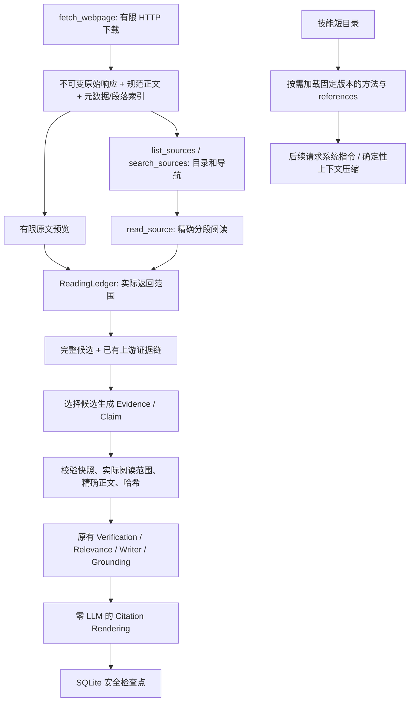

# Research Archive、按需读取与 Research Skills

本次修改保留 Python ResearchOrchestrator、任务 DAG、EvidenceStore、Verification、Relevance、补研究、Writer、确定性引用、CLI/API/SSE。只将 Researcher 内部模型/工具循环迁移到 LangChain `create_agent`，并接入项目管理的资料、技能、预算和上下文。没有增加技能分类器、Embedding、向量库或 LLM 摘要器。

## 数据流



目录、搜索引擎摘要、本地搜索导航、技能和模型草稿都不是原文证据。只有成功 fetch 的原文预览、`read_source` 实际返回范围以及现有正式上游 Evidence 可以进入对应抽取路径。Synthesis 可阅读授权档案以帮助理解，仍只能引用上游正式 Evidence，不能把新读片段直接变成新 Evidence。

## 存储与完整性的含义

本地默认 `SOURCE_ARCHIVE_PATH=workspace/source_archive`；Docker 为同一持久化卷下的 `/data/source_archive`。

```text
source_archive/
└── RUN_ID/
    ├── snapshots/snap_SHA256/
    │   ├── raw.bin           # Requests 返回的完整 HTTP entity bytes（已解传输压缩）
    │   ├── body.txt          # UTF-8 规范正文，所有 offset 的唯一基准
    │   ├── metadata.json     # URL、时间、类型、编码、状态、解析版本、哈希等
    │   └── sections.json     # 段落/分组索引，最多 4096 项，覆盖完整正文
    └── skills/SKILL_ID/VERSION_HASH/
        ├── SKILL.md
        └── references/*.md
```

`html-paragraph-text-v1` 使用现有 HTML 支持范围，剔除脚本、样式、导航等，以稳定换行组织可提取正文。保存的是本次 HTTP 成功返回的内容，**不代表整站、PDF 全文或模型已阅读整篇**。摘要页标记为 `abstract`；普通页面标记 `html_page`。可信注入工具的旧式文本响应只作为 `legacy_supplied_excerpt` 保存，不声称拿到了原始 HTTP 全文。

快照 ID 考虑最终 URL、正文哈希、响应哈希、解析版本及状态。同 URL 内容改变会生成新快照，旧目录不覆盖；默认 fetch 优先复用当前任务已授权的同 URL 快照，`refresh=true` 才尝试更新。目录采用暂存文件、fsync 和原子发布。元数据、raw、body、段落索引在读/恢复时校验。

网络失败、受限/空页面、解析失败、不支持的类型和下载超限返回明确状态。不会保存超限的半截响应并称其完整；PDF/OCR/动态浏览器未新增支持。认证头、Cookie 不落盘，不接受内嵌认证的 URL。网页正文自身可能含敏感信息，档案并非匿名化系统。

所有 `start_char` / `end_char` 都是 **Python Unicode 字符串索引**，半开区间 `[start_char, end_char)`，不是 UTF-8 字节或 JavaScript UTF-16 code unit。中文和 emoji 的调用方应遵守这个约定。

## 工具与授权

| 工具 | 主要参数 | 返回/语义 |
| --- | --- | --- |
| `fetch_webpage` | `url, max_chars, refresh=false` | 先存完整可获取内容，再返回有限原文预览、snapshot_id、范围、后续位置和是否复用。 |
| `list_sources` | `offset=0, limit=5, task_id?, keyword?` | 可分页授权资料卡片，含 URL、状态、正文长度和章节概况；不返回全文。 |
| `search_sources` | `query, limit=5` | 对完整授权正文进行确定性中英文关键词/n-gram 检索；返回最多 5 个短导航片段，须再 read_source。 |
| `read_source` | `snapshot_id, start_char=0, end_char?, section_id?, max_chars?` | 读取字符区间或章节；超出单次额度返回明确的实际范围、next_start_char 和 range_complete。 |
| `load_research_skill` | `skill_id` | 加载受信任产品方法，已激活版本重复调用返回缓存凭据。 |
| `read_skill_reference` | `skill_id, reference` | 只读已激活技能清单中明确允许的 `references/*.md` 文件。 |

授权来自当前任务清单和 **已提交、明确允许的依赖任务清单**，独立于有限长 EvidenceContext。目录不会通过扫描磁盘授予权限；跨 Run、无关 sibling、未提交任务、任意路径均拒绝。补研究沿用原有授权边界，不因新目录获得额外父任务权限。

每个任务/尝试都有独立资源对象、ReadingLedger、激活方法和累计计数。没有共享的 `Researcher.current_task` 等可变字段。失败/超时的私有快照可留在磁盘供本任务恢复，但不发布给下游。关闭的尝试不能将迟到结果发布为任务完成成果。

## 证据定位

新 Evidence 可带可选 `origin`，API/TypeScript 已兼容，旧数据为 `null`：

```json
{
  "snapshot_id": "snap_<64-character-sha256>",
  "start_char": 13000,
  "end_char": 13028,
  "text_hash": "<sha256-of-exact-evidence-text>",
  "body_hash": "<sha256-of-canonical-body>"
}
```

示例仅说明字段格式；真实 ID、范围和哈希由程序生成。模型只选择程序提供的候选，不能自造位置。生成正式 Evidence 时要求：

```python
archived_text[origin.start_char:origin.end_char] == evidence.content
```

同时校验快照、正文和片段哈希，以及该区间已被实际返回。重叠/相邻阅读范围取并集；不连续片段分别处理，不拼造连续原文。去首尾空白时同步调整 offset。去重包含快照身份和定位，避免同 URL 不同版本被错误合并；URL 层 Source 身份仍可规范化复用。

抽取不再统一 `text[:7500]`。优先去重并选择相关、来源分布均衡的完整候选，保留必要上游证据链；超限时移除完整候选或非事实草稿，不从中间剪断 JSON、URL、片段或链。材料仍放不下时明确失败，不声称覆盖全部。有限候选选择仍可能遗漏有用片段。

## Research Skills 的编写与版本

产品资源位于 `app/research_skills/`，不同于开发环境的 `.agents/skills/`。当前提供：

- `academic_review`：原始论文、研究问题/方法/数据集/基线/实验可比性、全文与摘要、局限。
- `technical_comparison`：版本、使用场景、公平比较维度、官方材料、条件与性能区别。
- `industry_analysis`：统计口径、时间地域、可核验数字、事实/预测/宣传、冲突材料。

初始请求只有短目录。Researcher 在原工具循环中自主选择方法，无单独 LLM 分类调用。下一次模型请求将完整选中方法和已读 reference 放入系统指令；工具历史只保留加载凭据，避免堆叠同一正文。确定性压缩也保留激活方法。没有合适方法时照常研究。

维护者编辑受信任的 `SKILL.md` / `references/*.md`，并在 `skills.py` 的固定目录注册新 ID。每技能最多 16 个文件，只允许安全 reference 文件名，每文件必须完整落在大小限制内，否则报错。方法不包含可执行 shell、任意导入或动态安装逻辑，不能覆盖证据、权限和预算。

首次 Researcher 执行将产品方法文件按内容哈希固定到 Run 档案。后续软件更新不替换旧 Run 的固定版本。恢复校验文件和清单哈希；缺失/损坏时明确报错，不静默套用新方法。Skills 不进入 EvidenceStore、不产生引用。

## 默认预算、单位与作用域

全部参数见 [.env.example](../.env.example)。以下计数是**每任务跨尝试/Resume 累计**；不是每次重试重置。单次 HTTP/模型请求和任务总时限继续生效，图步数上限 40。

| 配置 | 默认 | 单位/范围 |
| --- | --- | --- |
| Discovery / Analysis / Synthesis 外部 search、fetch | 3/4、2/3、0/0 | 现有每任务次数；补研究按原设置 2/2，并受共享预算约束。 |
| `MAX_SOURCE_CATALOG_CALLS` / `MAX_SOURCE_SEARCH_CALLS` / `MAX_SOURCE_READ_CALLS` | 8 / 8 / 12 | 本地工具调用次数，失败/重复也占用。 |
| `SOURCE_PREVIEW_CHARS` / `MAX_SOURCE_READ_CHARS` | 2400 / 4000 | 单次原文预览/读取字符上限。 |
| `MAX_TASK_SOURCE_CHARS` | 24000 | 累计返回正文字符，包括重复和导航短预览；先预留，失败不返还。 |
| `MAX_SOURCE_RESPONSE_BYTES` / `MAX_TASK_DOWNLOAD_BYTES` | 4 MiB / 32 MiB | 每 HTTP 完整 entity bytes/每任务预留下载量；每逻辑 fetch 最多 2 个 HTTP 尝试。 |
| `MAX_RUN_ARCHIVE_BYTES` / `MAX_RUN_ARCHIVE_SNAPSHOTS` | 128 MiB / 128 | 每 Run 磁盘大小（含技能/暂存）与快照数；未提供跨 Run 总配额/自动 GC。 |
| `MAX_RESEARCH_SKILLS` | 2 | 每任务激活方法数量。 |
| `MAX_SKILL_LOAD_CALLS` / `MAX_SKILL_REFERENCE_CALLS` | 4 / 4 | 方法/参考文件工具次数。 |
| `MAX_SKILL_FILE_CHARS` / `MAX_TASK_SKILL_CHARS` | 12000 / 18000 | 单文件完整大小/每任务全部激活方法及 references 字符数。 |
| `MAX_RESEARCH_MODEL_CALLS` | 14 | Researcher 正常循环 + 最多 1 次无工具 memo 恢复 + 最多 3 次抽取请求；预留 4 次收尾，正常循环最多 10 次。 |
| `MAX_RESEARCH_CONTEXT_ESTIMATED_TOKENS` | 65536 | 单次完整输入、工具/Schema 和输出预留的保守估算上限。 |
| `RESEARCH_MODEL_MAX_TOKENS` | 3072 | Researcher / memo 恢复单次输出上限；抽取沿用 `EVIDENCE_EXTRACTION_MAX_TOKENS=8192`。 |
| `MAX_TASK_ESTIMATED_TOKENS` | 300000 | 每任务累计输入估算 + 每次输出预留；正常循环另保留有限收尾余量，仍不保证任何材料都能放下。 |
| `ENFORCE_TASK_ESTIMATED_TOKEN_BUDGET` | true | false 关闭上一项累计额度拦截；不是关闭单次上下文、调用次数、超时或证据规则。 |
| `MAX_EXTRACTION_CANDIDATES` | 96 | 新原文候选的选择额度；必要上游材料不能任意剪断。 |

模型估算方法记录为 `utf8_bytes_plus_framing_v1_conservative`，按序列化 UTF-8 字节加消息/工具结构余量估算，**不是字符等于 Token，也不是已知 tokenizer 的精确值**。实际 usage 另存输入/输出与有 usage 的响应数量；不完整 usage 不能当作完整实际成本。供应商 SDK 内部 HTTP 重试仍由既有 `MODEL_MAX_RETRIES` 管理；这里计数的是模型 invoke 开始回调，不宣称统计所有底层网络尝试。

调用、下载、文本和模型额度在执行前加锁预留，失败不免费循环。隐藏耗尽工具后，执行侧仍检查；未知工具最多消耗 2 次无效调用额度后拒绝。普通任务预算与补研究共享模型预算同时生效，一个 invoke 在各自作用域各计一次，不在同一预算内重复记账。无工具 memo 最多一次，抽取兼容回退/compact 均计费；耗尽则有限结束或明确失败。

上下文先用归档范围凭据替换旧大段工具正文，再移除完整的旧 tool-call/result 组，保留当前任务、必要上游、激活方法和近期交互的配对关系；记录省略量，不增加摘要模型调用。主循环预算不含 Supervisor、Verifier、Relevance、Writer 等其他阶段，它们仍沿用原有独立限制。每任务小预算不等于整个 Run 的总成本承诺。

## Checkpoint 与升级

文件完整落盘后，SQLite 才引用快照。工具线程经 CheckpointManager 主事件循环提交私有资源预留，基于最后安全状态保存；任务完整成功/验证后才发布清单。资源修订号防止并发工具的旧快照覆盖新计数。不存在文件系统和 SQLite 的跨介质原子事务承诺；孤立文件不会自动授权，下游以安全清单为准。

新状态版本为 **2**。旧 `state_version=1` 在内存兼容为 2：无 origin 保留 None，无档案不伪造；下一次安全保存同时更新 `research_runs.state_version` 与 checkpoint 状态版本。无需删除数据库。旧已完成报告仍可读；需要继续研究的新档案/固定技能缺失或损坏会清楚报错。已完成 Run 可读保存文本，不要求重新下载/执行 Writer。

### 抽取失败后的恢复

如果已进入过证据抽取或无工具 memo 收尾，并保存了实际阅读范围（或授权上游正式 Evidence），Resume 会直接继续抽取，不重复搜索、Agent 循环和一次性 memo 收尾。Discovery 仍要求已有真实搜索记录；缺少原文时不会通过这个路径生成事实。最终公开 memo 仍由正式 Evidence / Claim 渲染，不把重建草稿当作事实来源。

抽取输入同时受单次上下文和**当前剩余累计估算额度**约束，优先选择完整候选，保留上游完整支持链，不切断原文、JSON 或证据引用。调用次数、一次性 memo、抽取最多三次等累计记录不重置。错误区分正常研究循环、memo、抽取和估算额度，并包含相关已用/上限；材料或额度不足时明确失败，不静默多发请求。

2026-11-06 对一个已反复失败的 task2 做只读离线回放：累计估算已用 269310、上限 300000；根据剩余额度选出 42 个完整候选，模拟下一次抽取输入与输出预留为 28763，合计 298073，原文定位校验通过。没有实际模型调用，也未修改原研究库；这说明该检查点具备继续抽取的预算条件，不代表已经完成真实研究或保证模型输出质量。

该恢复补丁新增 8 项离线测试，覆盖研究/收尾不重跑、抽取次数不重置、剩余额度选完整候选、上游链不可剪断、额度不足时不发送请求，以及真实 SQLite 检查点恢复到带引用的报告。针对性回归 72 passed；完整 Python 回归 **927 passed, 1 skipped（125.69 秒）**，跳过项为 Docker opt-in。日志位于未提交的 `workspace/validations/task2-resume/`。既有 Run 需重启后端后显式 Resume；本次未自动执行真实模型重跑。

### 关闭累计估算额度

对于分析/综合阶段，完整上游支持链不可任意删减；如果旧尝试已消耗大部分额度，选择候选仍无法放下最小必要材料。可以显式配置：

```dotenv
ENFORCE_TASK_ESTIMATED_TOKEN_BUDGET=false
```

修改后重启后端，再显式 Resume。该开关在每个未完成任务的新尝试上生效，包括已有检查点，不要求重建 Run。原 `estimated_tokens`、原额度与模型/工具次数继续累计，检查点记录 `estimated_token_budget_enforced=false`，允许已记录估算超过原累计额度。旧记录缺少此字段时默认为 true。没有修改 Verification、Relevance、Citation 或完整上游支持链校验。

单次上下文/输出上限、Researcher 总调用次数、memo 最多一次、抽取最多三次、工具/下载/正文限制和超时仍生效，因此不是无限重试。重新设为 true 后，如果某未完成任务的既有用量已经超过保存的上限，会明确拒绝继续，不清零记录；保持关闭或使用新 Run。读取已完成报告不受该切换影响。

2026-11-06：针对 task5 仅剩 2475、完整必要材料至少需要 28680 估算额度的情况，已按运行者要求在本机 `.env` 关闭该累计拦截。只读回放保留输入的全部 12 条上游 Claim 与 96 个完整候选，模拟请求后累计估算为 346207，超过原 300000 时的新检查点校验通过；真实模型调用为 0，原 Run 未修改。新增 9 项测试覆盖开关默认值、旧 Run 生效、超额记录保存/恢复、独立限制、重新启用及旧分析恢复至引用报告。完整 Python 回归 **936 passed, 1 skipped（137.21 秒）**；Docker opt-in 未运行。日志位于 `workspace/validations/task5-quota/`。

### 综合任务的上下文恢复

单次上下文限制独立于累计估算开关。最近两条工具正文也可能超出单次容量；必要时将它们替换为含精确 ID/位置的凭据，再省略助手工具规划的文字，保留结构化 tool calls、参数、ID 和配对 ToolMessage。目录/搜索凭据保留完整来源 ID 和命中区间，均不作为原文证据。压缩通知本身也计入预算，原始消息对象、ReadingLedger、档案及完整上游支持链不裁剪或改写。

如果当前 Agent 请求仍无法容纳，进入已有最多一次无工具 memo 收尾，而不继续堆积工具历史。已执行过研究的 synthesis 在 Resume 时，可直接用已授权的上游正式 Evidence 继续抽取，不再启动相同来源阅读循环。新阅读的原文仍不能绕过 synthesis 的“仅复用上游正式 Evidence”规则。调用计数、原始阅读记录、一次性收尾限制和单次上下文上限不重置。

2026-11-06：新增 8 项回归覆盖最近两段大正文、目录/搜索定位凭据、近期工具规划文字、过大必要输入拒绝发送、上下文溢出后的有限收尾，以及历史综合检查点恢复到带引用的报告。针对性回归 31 passed，完整 Python 回归 **944 passed, 1 skipped（104.59 秒）**；日志位于 `workspace/validations/task6-context/`，跳过项仍为 Docker opt-in。

对 task6 检查点的只读重建保留输入的 12 条上游 Claim，仅复用正式 Evidence，下一次抽取输入与输出预留估算为 28806，小于原 65536 单次上限；已有 9 次研究调用不增加。检查点不保存完整逐条模型历史，因此这是安全恢复请求的离线验证，不是原始历史的逐请求重放。没有发起真实模型调用或修改原 Run；重启后端后显式 Resume 验证真实结果。

### 补充研究的共享调用分配

`MAX_RERESEARCH_LLM_CALLS` 是一轮补研究的独立调用次数上限，不受累计 Token 估算开关影响。任务数增多后，不能把所有次数交给并行 Agent 自行争抢：研究循环可能耗尽预算，使抽取、Verification 和 Relevance 都无法执行。

现在在补研究计划保存后、工作线程启动前分配剩余调用，单任务研究循环最多 3 次，先预留抽取、逐任务 Verification 和整轮 Relevance。默认 DeepSeek JSON 路径、两项任务、12 次上限的基本分配为：规划 1，研究 3×2，抽取 1×2，验证 1×2，相关性 1。Native Schema 路径为抽取兼容回退多留一次，相应减少研究循环；不足以资助完整流程时明确停止，不自动放大预算。

研究循环触及自己的份额后，依据实际 ReadingLedger 直接抽取并渲染正式 memo，不另花一次模型请求重写草稿。工具已成功返回的搜索 URL 以有限私有导航元数据保留，防止 Agent 中断时丢失来源线索；必要的有限抓取仍在原工具额度内，导航信息不能成为 Evidence。已有的模型拒绝、原文定位、Claim 支持和引用校验继续生效。

共享准入与任务计数协调执行，共享预算拒绝的模型请求不再增加任务模型计数。任务份额、阶段保留量及已用次数随 checkpoint 保存/恢复，不清零、不重新瓜分；历史没有分配字段的预算仍可读取。验证拆批、服务超时或无可用来源仍可能让补研究留有缺口；分配保障基本流程机会，不保证所有模型重试都能放进固定 12 次。

补研究可失败而主报告仍完成，报告继续只用已有合格 Claim。已完成 Run 不自动重跑已经耗尽的补研究轮次；可以读取原报告，后续新 Run 使用新分配策略。

运行机器更新：

1. 停止对同一库的研究执行，备份数据库和已有整个档案根目录。最简单的一致性备份是在停止写入后一起复制；已有 SQLite backup 只备份数据库，**不能替代档案备份**。
2. 拉取/切换包含本功能的代码，保留原 `.env`，按需补充新变量；未配置新变量时默认可用。
3. 本地执行 `python -m pip install -e ".[dev]"`。Researcher 不再直接依赖 DeepAgents；不用手动删除 LangChain 正常需要的 LangGraph。
4. Docker 执行 `docker compose up -d --build --wait`，保留原项目名、`research_data` Volume；**不删除卷**。新目录默认 `/data/source_archive`，非 root 用户沿用原 `/data` 所有权。
5. 先用新 Run 验证创建、资料读取、报告及 Evidence API，再检查旧 Run 报告/证据；显式 Resume 一个可恢复 Run，确认版本升级与累计预算。

从 Windows 本地迁到 Linux/Docker，复制档案根目录中的 Run 子目录，同时设置新 `SOURCE_ARCHIVE_PATH`；checkpoint 内保留相对路径，无需重写 Windows 绝对路径。旧二进制不认识 v2，升级后若需回滚应使用升级前的一致性备份。

## 验证

可复现的固定 HTML、固定问题、脚本模型离线场景（不读真实 .env、不改真实数据库）：

```powershell
# 根目录，已安装 dev 依赖
.\.venv\Scripts\python.exe scripts/validate_research_resources.py
# 包含现有全部回归
.\.venv\Scripts\python.exe scripts/validate_research_resources.py --all
```

默认输出 `workspace/validations/research-resources/pytest.log`、`summary.json` 和 `offline-resource-metrics.json`。端到端场景通过真正的 create_agent 和现有 Pipeline，让关键事实只在第 12000 字符之后出现，预览不含该事实，然后加载学术技能、本地检索/read_source、精确抽取、Verification、报告引用、checkpoint 恢复。计数来自真实运行路径，模型内容/HTTP 均由固定 fixture 提供，Citation 和恢复终态不增加模型调用。

指标记录估算方法/输入与输出预留总量、Researcher/抽取调用、工具次数、返回正文字符、正式 Evidence 数与尾部覆盖、耗时；脚本模型没有真实 usage，因此该项为 null。**这些是离线模拟功能数据，不是模型质量、Token 降幅或性能提升的证据。** 本次实际结果见下方验证记录。

真实机器小预算验收（会调用已配置模型/搜索，需自行承担费用）：另开终端设置独立数据库/档案路径，不与生产 API 同库执行；使用一个窄问题和已知有长 HTML 正文的固定来源，例如“仅调研此 URL 的实验指标及局限，先定位并阅读 Results，再说明材料限制”，保留实际 URL/问题用于重复比较。

```powershell
$env:RESEARCH_DB_PATH='workspace/resource-smoke/research.db'
$env:SOURCE_ARCHIVE_PATH='workspace/resource-smoke/source_archive'
$env:MAX_RESEARCH_MODEL_CALLS='8'
$env:MAX_TASK_ESTIMATED_TOKENS='160000'
$env:MAX_RERESEARCH_ROUNDS='0'
.\.venv\Scripts\python.exe main.py "仅调研 https://your-known-source.example/study 的实验指标及局限，定位并阅读 Results，说明资料范围"
Remove-Item Env:RESEARCH_DB_PATH,Env:SOURCE_ARCHIVE_PATH,Env:MAX_RESEARCH_MODEL_CALLS,Env:MAX_TASK_ESTIMATED_TOKENS,Env:MAX_RERESEARCH_ROUNDS
```

先将示例 URL 换成可读取的固定原始资料。Supervisor 仍可拆分多个任务，以上是**每任务**限制；命中限制可明确失败，不以放宽验证过关。检查点的 `resources.tasks` 保存估算/usage 覆盖、模型/工具次数、返回字符、技能版本和 reading ranges；评估入口继续记录原有整个 Run 指标。审计 Evidence 的 origin 与 body.txt 区间、验证结果和报告引用，再比较重复运行；不要直接拿估算值替代供应商账单。

Docker 独立验收沿用 `RUN_DOCKER_TESTS=1 python -m pytest tests/test_deployment.py -q`，已增加固定技能可读、非 root 档案可写、容器重建后快照与版本哈希仍有效的断言。本机没有 Docker CLI/Engine，该项未运行。未使用真实模型，实际成本、搜索覆盖和报告质量尚未实测。

### 2026-11-06 验证记录

| 检查 | 实际结果 |
| --- | --- |
| 修改前 Python 离线基线 | 868 passed, 1 skipped；隔离工作目录、临时 SQLite，原库未修改。 |
| 修改后完整 Python 回归 | **919 passed, 1 skipped，57.19 秒**；新增 51 项资料/证据/技能/预算/恢复边界测试。唯一跳过项为 Docker opt-in。 |
| 前端单元 | **21 passed**。 |
| Chrome / Playwright 工作流 | **15 passed**，包括报告、引用、证据链、刷新、SSE 任务事件与重连。 |
| TypeScript / Vite | 类型检查与生产构建通过。 |
| Python Wheel | 构建与隔离安装通过；包含 3 个 SKILL.md、3 个 references、9 个 prompt，实际加载固定方法和写入/校验档案通过。 |
| CLI / 文档 | 临时库 `--list-runs` 退出 0；更新文档的本地链接目标通过。 |
| Docker / 真实模型 | 未运行：本机没有 Docker；本次只做无真实凭据的离线模型/HTTP 验证。 |

固定尾部场景本次记录：Researcher 与抽取共 **14 次脚本模型 invoke**，工具调用共 **8 次**，返回来源文本 **1116 个 Python 字符**，正式 Evidence **1 条**且定位超过第 12000 字符，离线完整流程约 **1.09 秒**。估算输入加输出预留合计 **294896**，方法为 `utf8_bytes_plus_framing_v1_conservative`；这是多个任务的合计，实际 usage 为 null。数字不代表线上耗时、实际收费 Token 或真实模型效果，不与旧架构虚构对比降幅。

本机完整日志和指标位于未提交的 `workspace/validations/archive-skills/delivery/`，可以用上述脚本重现。本轮未读取/打印真实 `.env` 密钥，也未打开或修改原研究数据库。

## 已知限制

- 不提供通用 RAG、向量数据库、自动 Skill 学习/下载/修改、任意文件/shell 工具或新前端阅读器。
- 只有阶段/任务级恢复，不恢复每条模型消息；累计额度保留，失败较多的任务可能已无足够额度继续。
- 未提供全局档案配额或自动清理；备份/留存需同时考虑 SQLite 和档案，不能随意删除仍需恢复的 Run 文件。
- 文件与 DB 不具备跨介质事务；进程硬退出可能留下孤立文件，未被提交清单引用的文件不自动共享。
- 有限候选/上下文和确定性关键词检索可能遗漏资料；保存全文不保证事实覆盖，不代表模型看完或结论必真。
- 仍为单后端/单 worker/单数据库执行进程，可信本地访问，无多租户、分布式调度或公网鉴权保证。
